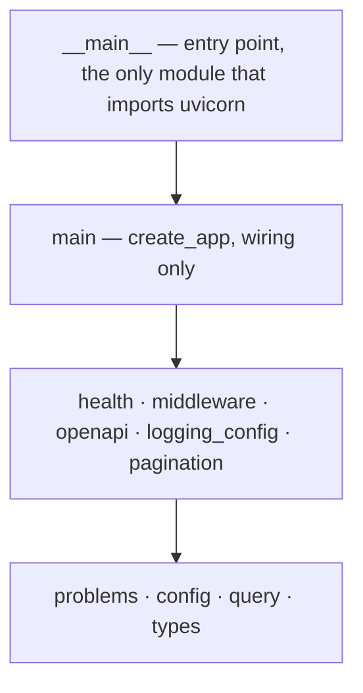

<div align="center">

# 🐍 fastapi-szumplate

[](https://github.com/JanSzewczyk/fastapi-szumplate/actions/workflows/ci.yml)
[&replace=%241&label=Python&logo=python&logoColor=white)](https://www.python.org/)
[%22&replace=%241&label=FastAPI&logo=fastapi&logoColor=white)](https://fastapi.tiangolo.com/)
[](LICENSE)
[](https://github.com/JanSzewczyk/fastapi-szumplate/generate) <!-- only:template -->

**FastAPI service with typed settings, structured logs, Problem Details and a checked OpenAPI contract**

[Features](#-features) • [Run it](#run-it) • [API](#-api) • [Configuration](#-configuration) • [Deployment](#-deployment)

</div>

---

## 👋 Hello there!

A FastAPI service by Szum-Tech with the parts every API needs already wired and tested: typed
settings, structured logging, one error format (Problem Details), a generated and checked OpenAPI
contract, Docker and CI. It runs on Python 3.15 with uv, Ruff, mypy (strict) and pytest, so work
starts from a green `make check` instead of an empty folder.
Use it as a GitHub template: one script renames your copy and, if you want, drops the example. <!-- only:template -->

<!-- begin:example -->
It ships an example domain (a small library) that you can delete.
<!-- end:example -->

### ⚡ Quick Start

```bash
git clone https://github.com/JanSzewczyk/fastapi-szumplate.git
cd fastapi-szumplate
cp .env.example .env
make install
make run
```

The API listens on http://127.0.0.1:8000; `curl http://127.0.0.1:8000/health` answers `{"status": "ok"}`.

## ✨ Features

### 🚀 What You Get

- **🩺 Health and readiness** — `GET /health` for liveness; `GET /health/ready` runs every registered check and answers a 503 problem that names the checks that failed
- **🔧 Typed settings** — pydantic-settings reads the environment and `.env`, and the service refuses to start on an invalid value
- **📝 Structured logs** — JSON or console output, an `X-Request-ID` on every response and log line, one access line per request, values under keys such as `password` or `token` redacted
- **🚨 One error format** — RFC 9457 Problem Details for 400, 404, 405, 422, 500 and every domain error, each domain error with its own stable `type`
- **📄 Checked OpenAPI contract** — `openapi.json` is generated from the app, committed, drift-checked by `make check`, linted by Spectral, diffed by oasdiff and fuzzed by Schemathesis
- **📑 Pagination** — a `Page[T]` envelope with `limit` and `offset` parameters
- **🔁 Strict requests** — a single-value query parameter sent twice is a 422, not a silent pick; a trailing slash is a 404, not a redirect
- **🛑 Graceful shutdown** — open requests get `GRACEFUL_SHUTDOWN_SECONDS` after SIGTERM, and responses carry no `Server` header
- **📚 Removable example domain** — books and loans with five rules that answer 409, each proven atomic by a parallel test <!-- only:example -->
- **🧩 Setup script** — `scripts/init_project.py` renames a copy and optionally drops the example <!-- only:template -->

### 🧱 Tech Stack

- [%22&replace=%241&label=FastAPI&logo=fastapi&logoColor=white)](https://fastapi.tiangolo.com/) — routing, validation and the OpenAPI document
- [%22&replace=%241&label=Pydantic&logo=pydantic&logoColor=white)](https://docs.pydantic.dev/) — request, response and problem models
- [%22&replace=%241&label=Pydantic%20Settings&logo=pydantic&logoColor=white)](https://docs.pydantic.dev/latest/concepts/pydantic_settings/) — typed configuration from the environment and `.env`
- [%22&replace=%241&label=structlog)](https://www.structlog.org/) — structured logging on top of the stdlib `logging`
- [%22&replace=%241&label=Uvicorn)](https://www.uvicorn.org/) — the ASGI server, started by `python -m fastapi_szumplate`

### 🧪 Quality Gates

- [%22&replace=%241&label=Ruff&logo=ruff&logoColor=white)](https://docs.astral.sh/ruff/) — format and lint, with security, async, logging and docstring rules
- [%22&replace=%241&label=mypy)](https://mypy.readthedocs.io/) — `strict = true` with the Pydantic plugin and extra error codes, over `src`, `tests` and `scripts`
- [%22&replace=%241&label=import-linter)](https://import-linter.readthedocs.io/) — contracts: the core is layered, only the entry point imports uvicorn, the core never imports the example
- [%22&replace=%241&label=pytest&logo=pytest&logoColor=white)](https://docs.pytest.org/) — strict mode, warnings are errors, random order, 60 s timeout per test
- [%22&replace=%241&label=coverage)](https://coverage.readthedocs.io/) — branch coverage of `src` and `scripts`, at least 95%
- [%22&replace=%241&label=Hypothesis)](https://hypothesis.readthedocs.io/) — property-based tests
- [%22&replace=%241&label=Schemathesis)](https://schemathesis.readthedocs.io/) — every check and phase against a running server

### 🤖 Automation & DevOps

- [](https://docs.astral.sh/uv/) — `uv.lock` and `uv sync --locked` everywhere; one uv version for the image and CI
- [](https://www.docker.com/) — multi-stage image, non-root user, `HEALTHCHECK`, and a `compose.yaml` that runs it read-only
- [](https://docs.github.com/actions) — `make check`, the contract tooling, the image and a free-threaded run on every pull request
- [](https://docs.github.com/code-security/dependabot) — weekly updates for uv, Actions and Docker images, after a 7-day cooldown
- **python-semantic-release** — versions, tags and GitHub Releases from Conventional Commits on `main`
- **pip-audit** — every locked dependency group, on every pull request and weekly

### 🧭 Scope & Design Decisions

- **One error format** — every error is Problem Details; clients branch on `type`, never on `detail`
- **Docs off by default** — `/docs`, `/redoc` and `/openapi.json` exist only with `DOCS_ENABLED=true`; leave them off on a public API
- **`python -m`, not the `uvicorn` command** — the module configures logging before uvicorn starts (see [Run it](#run-it))
- **One worker, one replica** — anything kept in memory is per process (see [Deployment](#-deployment))
- **No authentication** — out of scope; put it in a dependency on the routers you want to protect, and publish the security scheme in the OpenAPI document
- **No database** — the example keeps its data in memory behind a repository port; [swap-in-a-database.md](docs/how-to/swap-in-a-database.md) replaces it <!-- only:example -->
- **Structure when it hurts** — a module starts with the default shape and grows only when its rules demand it ([architecture.md](docs/explanation/architecture.md))

---

## 📖 Table of Contents

- [✨ Features](#-features)
- [🎯 Run it](#run-it)
- [🧩 Use it](#use-it) <!-- only:template -->
- [📃 Commands](#-commands)
- [📡 API](#-api)
- [🧱 Architecture](#-architecture)
- [🧪 Testing](#-testing)
- [🔧 Configuration](#-configuration)
- [🔒 Security](#-security)
- [🚀 Deployment](#-deployment)
- [🤖 CI](#-ci)
- [📁 Project Structure](#-project-structure)
- [📚 Documentation](#-documentation)
- [🩺 Troubleshooting](#-troubleshooting)
- [📝 Changelog](#-changelog)
- [🤝 Contributing](#-contributing)
- [📜 License](#-license)
- [📧 Contact & Support](#-contact--support)

---

## Run it

### 📋 Prerequisites

- **[Python](https://www.python.org/downloads/)** 3.15 — uv installs it for you when it is missing
- **[uv](https://docs.astral.sh/uv/)** 0.13.7 or newer, for dependencies and virtual environments
- **GNU Make** to run the commands below
- **Git** for version control
- **Docker** (optional) for `make docker-build`, `make docker-run`, Compose and `make api-breaking` without a local oasdiff
- **Node.js** (optional) for `make api-lint`, which runs Spectral through `npx`

### 📦 Installation

#### 1. Clone the Repository

```bash
git clone https://github.com/JanSzewczyk/fastapi-szumplate.git
cd fastapi-szumplate
```

#### 2. Install Dependencies

```bash
make install
```

This creates `.venv/` and installs the exact versions from `uv.lock` (`uv sync --locked`).

#### 3. Configure the Environment

```bash
cp .env.example .env
```

#### 4. Start the Service

```bash
make run
```

`make run` is `python -m fastapi_szumplate`. The API listens on http://127.0.0.1:8000. The
interactive docs (`/docs`, `/redoc`) and the spec (`/openapi.json`) are **off by default**, and
`.env.example` keeps them off. Set `DOCS_ENABLED=true` in your `.env` to read them while you
develop; leave them off on a public API.

Start it with `python -m fastapi_szumplate`, not with the `uvicorn` command. The module configures
logging before it starts uvicorn and tells uvicorn to leave it alone (`log_config=None`) and to skip
its own access log. If you must use the CLI, pass `--factory`
(`uvicorn fastapi_szumplate.main:create_app --factory`); you then get uvicorn's default log format
next to ours.

#### 5. Check It Works

```bash
curl http://127.0.0.1:8000/health
```

```json
{"status": "ok"}
```

<!-- begin:template -->
---

## Use it

Click **Use this template** on GitHub, clone your copy, then rename it and (optionally) drop the
example domain:

```bash
python scripts/init_project.py orders-api                    # keep the example
python scripts/init_project.py orders-api --without-example  # start from the bare service
uv sync --locked && make openapi && make check
```

The script renames the distribution, the package, its directory and every mention of the old
name, deletes itself, its test and the smoke script, and strips what only makes sense in the
template. Review the contact URL in `src/<package>/openapi.py` and the copyright holder in
`LICENSE` afterwards. CI proves on every change (job `template-smoke`, locally
`make smoke-template`) that both variants pass `make check`.

<!-- end:template -->
---

## 📃 Commands

| Command | Purpose |
| --- | --- |
| `make install` | Install locked dependencies (`uv sync --locked`) |
| `make run` | Start the service (`python -m fastapi_szumplate`) |
| `make format` | Ruff format |
| `make lint` | Ruff lint |
| `make typecheck` | mypy, strict |
| `make imports` | import-linter contracts (module boundaries) |
| `make test` | pytest |
| `make check` | What CI runs: format check, lint, mypy, import contracts, tests with coverage, OpenAPI drift |
| `make openapi` | Regenerate `openapi.json` from the app (never edit it by hand) |
| `make openapi-check` | Fail if `openapi.json` is out of date |
| `make api-lint` | Spectral on `openapi.json`, failing on warnings (needs Node; runs `npx`) |
| `make api-breaking` | oasdiff against `origin/main:openapi.json`, failing on breaking changes (needs oasdiff or Docker) |
| `make schemathesis` | Start the service, run Schemathesis with every check and phase, stop it |
| `make api-check` | `openapi-check`, `api-lint`, `api-breaking` and `schemathesis` |
| `make audit` | pip-audit on every locked dependency group |
| `make docker-build` / `make docker-run` | Build and run the image (needs Docker and a `.env`) |
| `make smoke-template` | Build projects from the template in a temp dir, with and without the example, and run their gates (slow) | <!-- only:template -->
| `make clean` | Remove caches and generated files |

`make check` is what CI runs; run it before you push.

---

## 📡 API

### 🔌 Endpoints

| Method | Path | Purpose |
| --- | --- | --- |
| `GET` | `/health` | Liveness (`get_health`): `{"status": "ok"}` while the process serves requests |
| `GET` | `/health/ready` | Readiness (`get_readiness`): 200 when every registered check passes, else a 503 problem |
| `GET` | `/v1/books` | List books, one page at a time (`list_books`) | <!-- only:example -->
| `POST` | `/v1/books` | Add a book; 201 with a `Location` header (`create_book`) | <!-- only:example -->
| `GET` | `/v1/books/{book_id}` | Fetch one book (`get_book`) | <!-- only:example -->
| `PUT` | `/v1/books/{book_id}` | Replace the title and author (`update_book`) | <!-- only:example -->
| `GET` | `/v1/loans` | List loans, optionally for one member or only active (`list_loans`) | <!-- only:example -->
| `POST` | `/v1/loans` | Lend a book to a member (`create_loan`) | <!-- only:example -->
| `GET` | `/v1/loans/{loan_id}` | Fetch one loan (`get_loan`) | <!-- only:example -->
| `POST` | `/v1/loans/{loan_id}/return` | Mark a loan as returned (`return_loan`) | <!-- only:example -->

The spec is generated from the app into `openapi.json` by `make openapi` and committed; never edit
it by hand. `make check` fails when it is out of date, and `make api-check` lints it, compares it
with `main` for breaking changes and runs Schemathesis against a live server. With
`DOCS_ENABLED=true` the service also serves `/docs`, `/redoc` and `/openapi.json`.
The create operations carry OpenAPI links to the operations that need their id, <!-- only:example -->
so stateful Schemathesis reaches them. <!-- only:example -->

### 🔎 Example

```bash
curl http://127.0.0.1:8000/health/ready
```

```json
{"status": "ready", "checks": {}}
```

Register a check with `register_readiness_check(app, "storage", check)`; its name then appears in
`checks` (`"ok"`), and a failing one turns the answer into a 503 `service-not-ready` problem that
names the check, not the error.

### 🚨 Errors

Every error is `application/problem+json` (RFC 9457) with `type`, `title`, `status`, `detail` and,
when known, `request_id`. Validation errors add `errors` with only `loc`, `msg` and `type`; the
submitted value is never echoed. Clients branch on `type`. See
[docs/reference/problem-types.md](docs/reference/problem-types.md).

```json
{
  "type": "about:blank",
  "title": "Not Found",
  "status": 404,
  "detail": "Not Found",
  "request_id": "..."
}
```

A 500 is answered by `UnhandledErrorMiddleware`, the innermost middleware, so it carries the
`X-Request-ID` header and, when CORS is on, the CORS headers (checked against uvicorn). The body is
the generic problem with the `request_id`; the traceback is logged once, on the `request_completed`
line of that request, without local variables.

Known limits:

- If the application fails after the response has started, the status and headers are already
  sent and cannot be replaced. The server cuts the connection and logs the traceback itself, while
  the `request_completed` line keeps the status that was sent but is logged at `error` with
  `aborted_by` set to the exception type.
- A failure in the middleware themselves is answered by Starlette's backstop handler: still the
  generic problem, but without `X-Request-ID` or CORS headers.
- A refused CORS preflight is a 400 problem too; a successful preflight is Starlette's bodyless
  `OK` (`text/plain`), which is not an error.

---

## 🧱 Architecture

`main.py` only wires the app: settings, logging, problem handlers, the OpenAPI clean-up, readiness,
the routers and three middleware (request context outermost, then CORS when it is on, then the 500
answer). import-linter enforces the layers of the core, top to bottom:



See [docs/explanation/architecture.md](docs/explanation/architecture.md) for why the layers are
drawn this way.

<!-- begin:example -->
The example domain is removable as a unit. It lives in `src/fastapi_szumplate/library/` with its
tests in `tests/library/`, and `include_library(app)` in `main.py` mounts it; nothing in the core
imports it. `library/books/` has the default module shape (router, schemas, models, service,
repository); `library/loans/` the hexagonal shape (domain, ports, service layer, adapters,
entrypoints).

Two module shapes are shown on purpose. Start every module like `books` (router, schemas, models,
service, repository). Move one to the `loans` shape (domain objects, ports, adapters) only when
its rules grow enough to hurt; see [docs/explanation/architecture.md](docs/explanation/architecture.md).

The example is a small library: books with a fixed number of copies, and loans with six rules
(unique ISBN, a free copy, three active loans per member, no repeat borrow, return once, not
before the borrow date). Each of the five guarded rules answers 409 with its own problem type
(for example `urn:problem:fastapi-szumplate:isbn-already-exists`) and has a parallel test that
fails when the guard is removed; the sixth (not before the borrow date) is a plain domain check
with a sequential test. Storage is in memory behind a repository port.
<!-- end:example -->

<!-- begin:example -->
### 🧹 Removing the example

Follow [docs/how-to/remove-the-example.md](docs/how-to/remove-the-example.md): it lists the steps
and what stays.
`python scripts/init_project.py <name> --without-example` does them for you, and CI proves on <!-- only:template -->
every change (job `template-smoke`, locally `make smoke-template`) that the result passes <!-- only:template -->
`make check`. <!-- only:template -->
<!-- end:example -->

<!-- begin:bare -->
Start every module with the default shape (router, schemas, models, service, repository); see
[docs/how-to/add-a-module.md](docs/how-to/add-a-module.md) and
[docs/explanation/architecture.md](docs/explanation/architecture.md).
<!-- end:bare -->

---

## 🧪 Testing

```bash
make test
```

- Tests mirror `src/`. They build settings with `Settings(_env_file=None)`, replace dependencies
  with `app.dependency_overrides` and build data with factories.
- Tests of the core use `/health` and the probe routes of `tests/probes.py`, so they never depend
  on a domain module.
- pytest runs in strict mode: unknown markers and config keys fail, and so does any warning.
- The order is random (pytest-randomly); `uv run pytest -p no:randomly` replays a run in file
  order. Every test has a 60 s timeout.
- `make check` runs the suite under coverage with branches and fails below 95%.
- `make schemathesis` starts the service and runs Schemathesis with every check and phase against
  `openapi.json`.

Parallel-guard tests carry the `concurrency` marker: `uv run pytest -m concurrency`. <!-- only:example -->

---

## 🔧 Configuration

All settings come from the environment or `.env` (see `.env.example`):

| Variable | Default | Meaning |
| --- | --- | --- |
| `APP_NAME` | `fastapi-szumplate` | API title |
| `ENVIRONMENT` | `local` | `local`, `test` or `production` |
| `LOG_LEVEL` | `INFO` | `DEBUG` to `CRITICAL` |
| `LOG_FORMAT` | `auto` | `json`, `console`, or `auto` (console when `local`, otherwise JSON) |
| `DOCS_ENABLED` | `false` | Serve `/docs`, `/redoc`, `/openapi.json` |
| `CORS_ORIGINS` | `[]` | JSON list of allowed origins; empty turns CORS off |
| `HOST`, `PORT`, `RELOAD` | `127.0.0.1`, `8000`, `false` | Server binding |
| `GRACEFUL_SHUTDOWN_SECONDS` | `20` | Time open requests get after SIGTERM; keep it below the orchestrator's grace period |
| `DEFAULT_PAGE_SIZE` | `20` | Page size when `limit` is omitted |
| `LOANS_MAX_ACTIVE_PER_MEMBER`, `LOAN_DAYS` | `3`, `14` | Example domain only | <!-- only:example -->

Every key is optional. An invalid value stops the service at start-up instead of failing later.

---

## 🔒 Security

- **Docs and spec off** — `/docs`, `/redoc` and `/openapi.json` are served only with `DOCS_ENABLED=true`
- **CORS off** — empty `CORS_ORIGINS` adds no CORS middleware; when on, credentials are not allowed
- **Nothing echoed back** — validation errors return `loc`, `msg` and `type` but never the submitted value, and a 500 carries no exception details
- **Redacted logs** — values under keys containing `password`, `token`, `authorization`, `api_key`, `secret` or `cookie` are logged as `***`; a safety net, not a licence to log secrets
- **No `Server` header** — uvicorn's server header is turned off
- **Hardened container** — the image runs as user `10001`, the virtual environment belongs to root, and `compose.yaml` adds a read-only filesystem, no capabilities and `no-new-privileges`
- **Audited dependencies** — `make audit` runs pip-audit on every locked group, in CI on every pull request and weekly; Dependabot waits 7 days before proposing a new release

Report a vulnerability through [GitHub issues](https://github.com/JanSzewczyk/fastapi-szumplate/issues).

---

## 🚀 Deployment

```bash
make docker-build
make docker-run
docker compose up --build
```

The image is multi-stage, runs as a non-root user and has a health check. `compose.yaml` runs it
with a read-only filesystem. Docker is not required for development.

`compose.yaml` reads `.env` through `env_file` with `required: false`, which needs Docker Compose
2.24 or newer. `make docker-run` and `compose.yaml` force `ENVIRONMENT=production`, `HOST` and
`PORT`; everything else comes from your `.env`.

Run one worker and one replica. Anything the app keeps in memory is per process, so a second
worker or replica would not see it.
The example's repositories and the locks that make its rules atomic (`threading.RLock`) are such <!-- only:example -->
state; move them to a database first, as <!-- only:example -->
[docs/how-to/swap-in-a-database.md](docs/how-to/swap-in-a-database.md) shows. <!-- only:example -->

Set `GRACEFUL_SHUTDOWN_SECONDS` below your orchestrator's grace period (Kubernetes: 30 s by
default). Behind a proxy, also set uvicorn's `FORWARDED_ALLOW_IPS`.

---

## 🤖 CI

`.github/workflows/ci.yml` runs on pushes to `main`, on pull requests, weekly and on demand:

- `check` — `make check`, a coverage summary and the dependency audit; the only job of the weekly run
- `api` — Spectral, oasdiff against `main` and Schemathesis (`make api-check`)
- `docker` — builds the image and starts it through `compose.yaml` until its health check passes, then calls `/health`
- `template-smoke` — renames a copy, with and without the example, then runs `make check` <!-- only:template -->
- `free-threaded` — the tests on free-threaded Python; informational, it never blocks a merge

Actions are pinned to exact version tags. `.github/dependabot.yml` proposes weekly updates for uv,
GitHub Actions and the Docker images, grouping minor and patch releases.

### 🏷️ Releases

`.github/workflows/release.yml` runs python-semantic-release on every push to `main`. It reads the
Conventional Commits since the last tag: `feat` bumps the minor version, `fix` and `perf` the patch
version, and `!` or a `BREAKING CHANGE:` footer the major version (while the version is `0.x`, a
breaking change bumps the minor). Other types release nothing. A release updates `version` in
`pyproject.toml` and `uv.lock`, pushes a `chore(release): X.Y.Z` commit and the `vX.Y.Z` tag, adds the
release to `CHANGELOG.md` and creates the GitHub Release with generated notes. Preview the next
version locally with `uv run --group release semantic-release --noop version --print`.

<!-- begin:template -->
The release step is commented out in the template; `scripts/init_project.py` enables it in a copy.

<!-- end:template -->

If `main` is protected, the workflow's token must be allowed to push to it (a ruleset bypass).

---

## 📁 Project Structure

```text
src/fastapi_szumplate/
  main.py            create_app(settings): wiring only
  __main__.py        python -m fastapi_szumplate
  config.py          Settings (pydantic-settings), get_settings dependency
  logging_config.py  structlog on stdlib: JSON or console, redaction, idempotent
  middleware.py      request id, bound log context, one access-log line per request
  problems.py        Problem Details model, handlers for 404/405/422/500, domain error mapping
  openapi.py         API metadata and the document clean-up
  query.py           rejects a single-value query parameter given more than once
  types.py           IsoDate, IsoAwareDatetime, WholeNumber
  pagination.py      Page[T] envelope and limit/offset parameters
  health/            GET /health (liveness), GET /health/ready (readiness, 503 problem)
tests/               mirrors src
scripts/             export_openapi.py, run_schemathesis.sh
docs/                how-to guides, reference, explanation
```

<!-- begin:template -->
`scripts/init_project.py` (rename the copy, optionally drop the example) and
`scripts/smoke_template.sh` (prove the result passes its gates) exist only in the template.
<!-- end:template -->

### 📂 Key Directories

- **`src/fastapi_szumplate/`** — the service; the core modules above plus one package per feature
- **`tests/`** — pytest suite, one test module per source module, with `conftest.py` and the probe routes of `probes.py`
- **`scripts/`** — the OpenAPI export and the Schemathesis runner that the Makefile calls
- **`docs/`** — how-to guides, the problem type reference and the architecture notes

### 🧾 Important Configuration Files

- **`pyproject.toml`** — dependencies and groups, Ruff, mypy, pytest, coverage and import-linter
- **`uv.lock`** — the locked versions every install uses
- **`Makefile`** — every command above
- **`.env.example`** — every setting with its default
- **`openapi.json`** — the generated contract
- **`.spectral.yaml`**, **`schemathesis.toml`** — rules for the contract tooling
- **`Dockerfile`**, **`compose.yaml`**, **`.dockerignore`** — the image and how to run it
- **`.github/workflows/ci.yml`**, **`.github/workflows/release.yml`**, **`.github/dependabot.yml`** — CI, releases and dependency updates

---

## 📚 Documentation

- **How-to**
  - [Add a module](docs/how-to/add-a-module.md)
  - [Remove the example](docs/how-to/remove-the-example.md) <!-- only:example -->
  - [Swap in a database](docs/how-to/swap-in-a-database.md) <!-- only:example -->
- **Reference** — [Problem types](docs/reference/problem-types.md)
- **Explanation** — [Architecture](docs/explanation/architecture.md)

---

## 🩺 Troubleshooting

- **`/docs` answers 404** — the docs are off by default; set `DOCS_ENABLED=true` in `.env`
- **`/health/` answers 404** — a trailing slash is not redirected; call `/health`
- **Two log formats side by side** — the service was started with the `uvicorn` command; use `make run` or pass `--factory`
- **`make openapi-check` fails** — the API changed; run `make openapi` and commit `openapi.json`
- **`make schemathesis` says the port is in use** — set `SCHEMATHESIS_PORT` to a free port
- **`make api-breaking` skips the check** — `origin/main` has no `openapi.json` yet
- **Compose rejects `env_file`** — `required: false` needs Docker Compose 2.24 or newer
- **The container ignores `ENVIRONMENT`, `HOST` or `PORT` from `.env`** — `make docker-run` and `compose.yaml` force them on purpose

---

## 📝 Changelog

Releases and their changes are listed on the repository's GitHub Releases page. The first release
also generates `CHANGELOG.md` from the Conventional Commits.

---

## 🤝 Contributing

1. Fork the repository
2. Create a feature branch (`git checkout -b feature/amazing-feature`)
3. Run `make check` until it passes
4. Commit your changes using [Conventional Commits](https://www.conventionalcommits.org/)
5. Open a Pull Request

---

## 📜 License

This project is licensed under the **MIT License**. See the [LICENSE](LICENSE) file for details.

---

## 📧 Contact & Support

- 🐛 [Open an issue](https://github.com/JanSzewczyk/fastapi-szumplate/issues)
- ⭐ [Star this repository](https://github.com/JanSzewczyk/fastapi-szumplate)
- 👨‍💻 Check out the maintainer's [GitHub profile](https://github.com/JanSzewczyk)

---

<div align="center">

**Made with ❤️ by [Szum-Tech](https://github.com/JanSzewczyk)**

If this service helped you, please consider giving it a ⭐ on GitHub!

[⬆ Back to Top](#-fastapi-szumplate)

</div>
