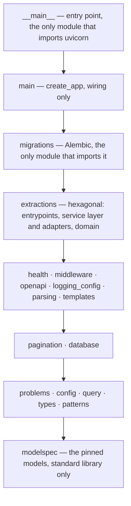

<div align="center">

# 🐍 formlens

[](https://github.com/JanSzewczyk/form-lens-api/actions/workflows/ci.yml)
[&replace=%241&label=Python&logo=python&logoColor=white)](https://www.python.org/)
[%22&replace=%241&label=FastAPI&logo=fastapi&logoColor=white)](https://fastapi.tiangolo.com/)
[](LICENSE)

**FastAPI service that extracts structured data from forms with a document model that runs locally**

[Features](#-features) • [Run it](#run-it) • [API](#-api) • [Configuration](#-configuration) • [Deployment](#-deployment)

</div>

---

## 👋 Hello there!

FormLens API by Szum-Tech turns forms into structured data with models that run on your machine; no
document leaves it. IBM's Granite-Docling model, through [Docling](https://github.com/docling-project/docling),
reads a PDF, PNG, JPEG or TIFF into text (`POST /v1/documents/parse`). **Stage 2 adds form templates and
extraction**: you describe the fields of a form once (`/v1/templates`), upload a document with the template
(`POST /v1/extractions`) and read the values back later (`GET /v1/extractions/{id}`). A local language model
([Ollama](https://ollama.com), `qwen3:8b` by default) fills in the fields from the text, one job at a time from a
queue in the same process. Around it are typed settings, structured logging, one error format (Problem Details),
a generated and checked OpenAPI contract, a pinned model download, SQLite with migrations, Docker and CI. It
runs on Python 3.15 with uv, Ruff, mypy (strict) and pytest.

### ⚡ Quick Start

```bash
git clone https://github.com/JanSzewczyk/form-lens-api.git
cd form-lens-api
cp .env.example .env
make install
make download-models   # about 0.6 GB, once; the service does not start without the model
make migrate           # creates the SQLite database; the service does not start on an old one
ollama pull qwen3:8b   # the language model, once (see docs/how-to/run-the-llm.md)
make run               # loads the model (about 5 s with warm disk caches, 11 s cold), then listens
```

The API listens on http://127.0.0.1:8000. Read a document's text, or extract fields with a template:

```bash
curl -F "file=@invoice.pdf" http://127.0.0.1:8000/v1/documents/parse
curl -X POST -H "Content-Type: application/json" http://127.0.0.1:8000/v1/templates \
  -d '{"name": "Invoice", "fields": [{"name": "number", "type": "text", "required": true}]}'
curl -i -F "template_id=<id from the answer>" -F "file=@invoice.pdf" http://127.0.0.1:8000/v1/extractions
```

## ✨ Features

### 🚀 What You Get

- **📄 Document parsing** — `POST /v1/documents/parse` runs Granite-Docling through Docling on this machine and returns `text`, `page_count`, `elapsed_ms` and `model`; the file type is read from its bytes, at most `MAX_CONCURRENCY` documents are read at once, and a busy service answers 503 with `Retry-After`
- **🧩 Form templates** — `/v1/templates` creates, lists, reads, replaces and deletes the description of a form: fields of type `text`, `number`, `integer`, `boolean`, `date` or `choice`, with limits. Each template yields a JSON Schema (every field a required key that may be `null`), versions go up by one with every replacement, and a template that breaks a rule is a 422 `invalid-template`
- **🔎 Field extraction** — `POST /v1/extractions` queues a document and answers 202 with a `Location`; one worker reads the text with Docling and asks a local Ollama model for the fields, and the answer is validated against the template's schema. The extraction keeps a copy of the template from the moment it was submitted
- **📥 A queue that says no** — at most `QUEUE_MAX_PENDING` extractions wait; one more is a 503 `queue-full` with `Retry-After`. A job runs at most `JOB_TIMEOUT_SECONDS`, is retried while attempts remain, and one that a restart interrupted is run again
- **🩺 Health and readiness** — `GET /health` for liveness; `GET /health/ready` runs every registered check and answers a 503 problem that names the checks that failed
- **🔧 Typed settings** — pydantic-settings reads the environment and `.env`, and the service refuses to start on an invalid value
- **📝 Structured logs** — JSON or console output, an `X-Request-ID` on every response and log line, one access line per request, values under keys such as `password` or `token` redacted
- **🚨 One error format** — RFC 9457 Problem Details for 400, 404, 405, 422, 500 and every domain error, each domain error with its own stable `type`
- **📄 Checked OpenAPI contract** — `openapi.json` is generated from the app, committed, drift-checked by `make check`, linted by Spectral, diffed by oasdiff and fuzzed by Schemathesis
- **📑 Pagination** — a `Page[T]` envelope with `limit` and `offset` parameters
- **🔁 Strict requests** — a single-value query parameter sent twice is a 422, not a silent pick; a trailing slash is a 404, not a redirect
- **🛑 Graceful shutdown** — open requests get `GRACEFUL_SHUTDOWN_SECONDS` after SIGTERM, and responses carry no `Server` header

### 🧱 Tech Stack

- [%22&replace=%241&label=FastAPI&logo=fastapi&logoColor=white)](https://fastapi.tiangolo.com/) — routing, validation and the OpenAPI document
- [%22&replace=%241&label=Pydantic&logo=pydantic&logoColor=white)](https://docs.pydantic.dev/) — request, response and problem models
- [%22&replace=%241&label=Pydantic%20Settings&logo=pydantic&logoColor=white)](https://docs.pydantic.dev/latest/concepts/pydantic_settings/) — typed configuration from the environment and `.env`
- [%22&replace=%241&label=structlog)](https://www.structlog.org/) — structured logging on top of the stdlib `logging`
- [%22&replace=%241&label=Uvicorn)](https://www.uvicorn.org/) — the ASGI server, started by `python -m formlens`

- [SQLAlchemy](https://www.sqlalchemy.org/) and [Alembic](https://alembic.sqlalchemy.org/) — the SQLite database and its migrations (`make migrate`); [httpx2](https://pypi.org/project/httpx2/) — the client of the local model; [jsonschema](https://python-jsonschema.readthedocs.io/) — validates what the model returns against the template's schema
- **Docling with Granite-Docling** — the document model, a runtime dependency (`docling[vlm]`, with `torch` and, on Apple Silicon, `mlx-vlm`); `python-multipart` reads the upload. Their licences are in [docs/licenses.md](docs/licenses.md)

### 🧪 Quality Gates

- [%22&replace=%241&label=Ruff&logo=ruff&logoColor=white)](https://docs.astral.sh/ruff/) — format and lint, with security, async, logging and docstring rules
- [%22&replace=%241&label=mypy)](https://mypy.readthedocs.io/) — `strict = true` with the Pydantic plugin and extra error codes, over `src`, `tests` and `scripts`
- [%22&replace=%241&label=import-linter)](https://import-linter.readthedocs.io/) — eleven contracts: the core is layered, only the entry point imports uvicorn, only the Docling adapter imports Docling, torch, transformers, mlx-vlm or Pillow, only `main` imports that adapter, only the persistence modules import SQLAlchemy and only the migrations Alembic, only the Ollama adapter imports the HTTP client and jsonschema, the extraction domain imports no framework, and `parsing`, `templates` and `extractions` are layered inside
- [%22&replace=%241&label=pytest&logo=pytest&logoColor=white)](https://docs.pytest.org/) — strict mode, warnings are errors, random order, 60 s timeout per test
- [%22&replace=%241&label=coverage)](https://coverage.readthedocs.io/) — branch coverage of `src` and `scripts`, at least 95%
- [%22&replace=%241&label=Hypothesis)](https://hypothesis.readthedocs.io/) — property-based tests
- [%22&replace=%241&label=Schemathesis)](https://schemathesis.readthedocs.io/) — every check and phase against a running server

### 🤖 Automation & DevOps

- [](https://docs.astral.sh/uv/) — `uv.lock` and `uv sync --locked` everywhere; one uv version for the image and CI
- [](https://www.docker.com/) — multi-stage image, non-root user, `HEALTHCHECK`, and a `compose.yaml` that runs it read-only
- [](https://docs.github.com/actions) — `make check`, the contract tooling and the image on every pull request
- [](https://docs.github.com/code-security/dependabot) — weekly updates for uv, Actions and Docker images, after a 7-day cooldown
- **python-semantic-release** — versions, tags and GitHub Releases from Conventional Commits on `main`
- **pip-audit** — every locked dependency group, on every pull request and weekly

### 🧭 Scope & Design Decisions

- **One error format** — every error is Problem Details; clients branch on `type`, never on `detail`
- **Docs off by default** — `/docs`, `/redoc` and `/openapi.json` exist only with `DOCS_ENABLED=true`; leave them off on a public API
- **`python -m`, not the `uvicorn` command** — the module configures logging before uvicorn starts (see [Run it](#run-it))
- **One worker, one replica** — anything kept in memory is per process (see [Deployment](#-deployment))
- **The model is never fetched at run time** — the service sets `HF_HUB_OFFLINE=1`, loads the pinned model from `MODELS_PATH` at start-up and stops with `model_load_failed` when a file is missing; a test proves that it makes no network attempt
- **No authentication** — out of scope; put it in a dependency on the routers you want to protect, and publish the security scheme in the OpenAPI document
- **Structure when it hurts** — a module starts with the default shape and grows only when its rules demand it ([architecture.md](docs/explanation/architecture.md))

---

## 📖 Table of Contents

- [✨ Features](#-features)
- [🎯 Run it](#run-it)
- [📃 Commands](#-commands)
- [📡 API](#-api)
- [🧱 Architecture](#-architecture)
- [🧪 Testing](#-testing)
- [🎯 Accuracy](#-accuracy)
- [🔧 Configuration](#-configuration)
- [🔒 Security](#-security)
- [🚀 Deployment](#-deployment)
- [🤖 CI](#-ci)
- [📁 Project Structure](#-project-structure)
- [📚 Documentation](#-documentation)
- [🩺 Troubleshooting](#-troubleshooting)
- [📝 Changelog](#-changelog)
- [🤝 Contributing](#-contributing)
- [📜 License](#-license)
- [📧 Contact & Support](#-contact--support)

---

## Run it

### 📋 Prerequisites

- **[Python](https://www.python.org/downloads/)** 3.15 — uv installs it for you when it is missing
- **macOS 14 or newer on Apple Silicon** for the default `VLM_BACKEND=mlx`, the backend this project uses on Apple Silicon (macOS 14 is the minimum for the macOS `mlx` wheels). This project has run it only there. On other systems set `VLM_BACKEND=transformers`; that backend has been neither downloaded nor run so far
- **[uv](https://docs.astral.sh/uv/)** 0.13.7 or newer, for dependencies and virtual environments
- **GNU Make** to run the commands below
- **Git** for version control
- **[Ollama](https://ollama.com)** with the language model pulled (`ollama pull qwen3:8b`): the service starts without it, but an extraction fails with `llm_unavailable` until it answers (see [docs/how-to/run-the-llm.md](docs/how-to/run-the-llm.md))
- **Docker** (optional) for `make docker-build`, `make docker-run`, Compose and `make api-breaking` without a local oasdiff
- **Node.js** (optional) for `make api-lint`, which runs Spectral through `npx`

### 📦 Installation

#### 1. Clone the Repository

```bash
git clone https://github.com/JanSzewczyk/form-lens-api.git
cd form-lens-api
```

#### 2. Install Dependencies

```bash
make install
```

This creates `.venv/` and installs the exact versions from `uv.lock` (`uv sync --locked`).

#### 3. Configure the Environment

```bash
cp .env.example .env
```

#### 4. Download the Model

```bash
make download-models
```

This fetches the model pinned for `VLM_BACKEND` (about 0.6 GB for `mlx`) into `MODELS_PATH`
(`models/` by default, git-ignored) as `models/ibm-granite--granite-docling-258M-mlx/`. It needs
network access and uv, and does nothing when the pinned revision is already there. A relative
`MODELS_PATH` is read from the working directory, as the service reads it (`make` runs from the
repository root). `make test-models` then checks that the files are in place. An empty
`MODELS_PATH` or `VLM_BACKEND` is refused, by the script as by the service. Licences:
[docs/licenses.md](docs/licenses.md).

**The download, the check and the service read the same two settings the same way.**
`make download-models` asks `scripts/resolve_model.py`, which reads `MODELS_PATH` and `VLM_BACKEND`
through the same settings class as the service: the environment (and the variables you pass to
`make`) first, then a `.env` in the working directory, then the defaults. A `.env` with
`MODELS_PATH=/elsewhere` or `VLM_BACKEND=transformers` therefore moves the download, `make test-models`
and `make run` together, and an exported variable beats the file for all three. An unrelated bad
value in `.env` (`PORT=abc`) stops the service but not the download. The script runs the resolver
with `uv run --no-sync`, so run `make install` first. You can still pass the variables on the
command line:

```bash
make download-models VLM_BACKEND=transformers MODELS_PATH=/data/models
make test-models VLM_BACKEND=transformers MODELS_PATH=/data/models
```

The repositories and revisions are pinned in `src/formlens/modelspec.py`, the one place that names them.

`HF_CLI` replaces the downloader (the tests use a fake one). It is split on spaces into a command
and its arguments, so a path that contains a space does not work; point it at a wrapper script
whose path has none.

#### 5. Install the Language Model

Install [Ollama](https://ollama.com) and run `ollama pull qwen3:8b`; the service reaches it at
`LLM_BASE_URL` (`http://localhost:11434/v1`). The service starts without it. Details, and what has and has not
been checked against a real Ollama, are in [docs/how-to/run-the-llm.md](docs/how-to/run-the-llm.md).

#### 6. Create the Database

```bash
make migrate
```

This creates or updates the SQLite file named by `DB_URL` (`./formlens.db`, git-ignored). The service
checks at start-up that the database is at the newest revision and **refuses to start** otherwise, logging
`database_not_migrated` with this command as the hint. It never creates tables itself.

#### 7. Start the Service

```bash
make run
```

`make run` is `python -m formlens`. It loads the model first (a few seconds; the service answers
nothing until it is loaded) and fails at once, with a `model_load_failed` log line, when the model
is missing from `MODELS_PATH`. The API listens on http://127.0.0.1:8000. The
interactive docs (`/docs`, `/redoc`) and the spec (`/openapi.json`) are **off by default**, and
`.env.example` keeps them off. Set `DOCS_ENABLED=true` in your `.env` to read them while you
develop; leave them off on a public API.

Start it with `python -m formlens`, not with the `uvicorn` command. The module configures
logging before it starts uvicorn and tells uvicorn to leave it alone (`log_config=None`) and to skip
its own access log. If you must use the CLI, pass `--factory`
(`uvicorn formlens.main:create_app --factory`); you then get uvicorn's default log format
next to ours.

#### 8. Check It Works

```bash
curl http://127.0.0.1:8000/health/ready
```

```json
{"status": "ready", "checks": {"model": "ok"}}
```

Then read a document (the synthetic files in `tests/data/` work):

```bash
# Markdown (the default)
curl -F "file=@tests/data/text_layer.pdf" http://127.0.0.1:8000/v1/documents/parse
# Plain text
curl -F "file=@tests/data/sample.png" "http://127.0.0.1:8000/v1/documents/parse?format=text"
```

```json
{"text": "FormLens synthetic sample Invoice 2024-001 Total: 120.00 EUR", "page_count": 1, "elapsed_ms": 1802, "model": "ibm-granite/granite-docling-258M-mlx"}
```

The small model sometimes repeats a line of a page; do not expect the text to equal the document.

To extract fields, create a template, queue a document with it and poll the `Location`:

```bash
curl -s -X POST -H "Content-Type: application/json" http://127.0.0.1:8000/v1/templates \
  -d '{"name": "Invoice", "fields": [{"name": "number", "type": "text", "required": true}, {"name": "total", "type": "number"}]}'
curl -i -F "template_id=<id>" -F "file=@tests/data/text_layer.pdf" http://127.0.0.1:8000/v1/extractions
curl http://127.0.0.1:8000/v1/extractions/<id from the Location header>
```

### ⏱ How long a page takes

Measured on an Apple M1 Pro (10 cores: 8 performance and 2 efficiency, 32 GB, macOS 27.2), `VLM_BACKEND=mlx`, model revision
`e9939db25d2f296c8678d0491c4609a8c596c50a` (`ibm-granite/granite-docling-258M-mlx`),
`make run` and `curl`, one request at a time, one-page synthetic documents of `tests/data/`
(520 x 160 px images, a one-page PDF):

| Step | Time |
| --- | --- |
| Loading the model at start-up (`/health/ready` answers 200) | about 4.9 s with the files in the disk cache (three runs), about 11 s after a cold disk |
| First request after start, PDF with a text layer | 1.8 s (three runs: 1.80, 1.84, 1.81) |
| First request after start, PNG | 1.5 s (three runs: 1.53, 1.50, 1.52) |
| Later requests, PDF with a text layer / PDF scan | 1.65 s / 1.24 s (five runs each) |
| Later requests, PNG / JPEG / TIFF | 1.40 s / 1.21 s / 1.41 s (five runs each) |

A page takes 1.2 to 1.8 s here, and the first request is only about 0.1 to 0.2 s slower than the
next ones, because the model is loaded at start-up. These are the numbers of this one machine and
backend; the `transformers` backend (the container's) has not been measured and is slower on a CPU.
A document of many pages takes about that long per page, and `PARSE_TIMEOUT_SECONDS` is checked only
after each batch of 4 pages (Docling's `page_batch_size`) and after the last one: a document can run
past the budget by up to a batch, and one that finishes over the budget fails too (a one-page PNG that
took 1.59 s failed with a 1 s budget). It is not a hard stop. The `Retry-After` of a busy answer is a
constant 5 seconds: a one-page document frees its slot sooner, but a longer document does not, and
nothing here measures the container's backend, so the constant stays.

---

## 📃 Commands

| Command | Purpose |
| --- | --- |
| `make install` | Install locked dependencies (`uv sync --locked`) |
| `make run` | Start the service (`python -m formlens`) |
| `make migrate` | Create or update the database tables of `DB_URL` (`python -m formlens migrate`); run it before the first start |
| `make evaluate` | Read the golden set (48 synthetic documents) with the real models and print how many fields were right (`python -m tests.golden.evaluate`); needs Ollama and the document model, and says so when it cannot run |
| `make format` | Ruff format |
| `make lint` | Ruff lint |
| `make typecheck` | mypy, strict |
| `make imports` | import-linter contracts (module boundaries) |
| `make test` | pytest, without the `slow` tests that need the downloaded models |
| `make test-models` | Every `slow` test (`pytest -m slow`): the model files, the real model through the app and the offline check. They fail, not skip, unless the pinned model files are under `MODELS_PATH` (run `make download-models` first) |
| `make download-models` | Download the pinned Granite-Docling model for `VLM_BACKEND` into `MODELS_PATH` (needs network, uv and about 0.6 GB) |
| `make check` | What CI runs: format check, lint, mypy, import contracts, tests with coverage, OpenAPI drift |
| `make openapi` | Regenerate `openapi.json` from the app (never edit it by hand) |
| `make openapi-check` | Fail if `openapi.json` is out of date |
| `make api-lint` | Spectral on `openapi.json`, failing on warnings (needs Node; runs `npx`) |
| `make api-breaking` | oasdiff against `origin/main:openapi.json`, failing on breaking changes except those listed in `oasdiff-ignore.txt` (the removed example routes; delete the file after the first merge to `main`); needs oasdiff or Docker |
| `make schemathesis` | Start the service, run Schemathesis with every check and phase, stop it |
| `make api-check` | `openapi-check`, `api-lint`, `api-breaking` and `schemathesis` |
| `make audit` | pip-audit on every locked dependency group |
| `make docker-build` / `make docker-run` | Build and run the image (needs Docker and a `.env`) |
| `make clean` | Remove caches and generated files |

`make check` is what CI runs; run it before you push.

---

## 📡 API

### 🔌 Endpoints

| Method | Path | Purpose |
| --- | --- | --- |
| `GET` | `/health` | Liveness (`get_health`): `{"status": "ok"}` while the process serves requests |
| `GET` | `/health/ready` | Readiness (`get_readiness`): 200 when every registered check passes (`model`: the document model is loaded), else a 503 problem |
| `POST` | `/v1/documents/parse` | Parse a document (`parse_document`): multipart `file` (a PDF, PNG, JPEG or TIFF, at most `MAX_UPLOAD_MB`) and the query parameter `format` (`markdown`, the default, or `text`); answers `text`, `page_count`, `elapsed_ms` and `model` |
| `POST` | `/v1/templates` | Create a template (`create_template`): 201 with the template, its `version` (1) and its generated `json_schema` |
| `GET` | `/v1/templates` | List templates (`list_templates`), oldest first, as a `Page` (`limit`, `offset`) |
| `GET` | `/v1/templates/{template_id}` | Read a template (`get_template`) |
| `PUT` | `/v1/templates/{template_id}` | Replace a template (`replace_template`): the whole body again; the `version` goes up by one |
| `DELETE` | `/v1/templates/{template_id}` | Delete a template (`delete_template`): 204; extractions already submitted keep their copy |
| `POST` | `/v1/extractions` | Queue a document (`create_extraction`): multipart `file` and the form field `template_id`; **202** with a `Location` header and the extraction as `pending` |
| `GET` | `/v1/extractions/{extraction_id}` | Read an extraction (`get_extraction`): `status`, `result`, `error`, `missing_required`, the template id and version, timestamps |

The spec is generated from the app into `openapi.json` by `make openapi` and committed; never edit
it by hand. `make check` fails when it is out of date, and `make api-check` lints it, compares it
with `main` for breaking changes and runs Schemathesis against a live server. With
`DOCS_ENABLED=true` the service also serves `/docs`, `/redoc` and `/openapi.json`.

### 🔎 Example

```bash
curl http://127.0.0.1:8000/health/ready
```

```json
{"status": "ready", "checks": {"model": "ok"}}
```

The `model` check passes once the document model is loaded. Register another with
`register_readiness_check(app, "storage", check)`; its name then appears in `checks` (`"ok"`), and a
failing one turns the answer into a 503 `service-not-ready` problem that names the check, not the
error.

#### Templates and extractions

A **template** lists the fields of a form. A field has a `name` (lower case letters, digits and `_`, starting with
a letter, unique), a `type` (`text`, `number`, `integer`, `boolean`, `date`, `choice`), an optional `description`
(how it appears on the form: it helps the model), `required`, and what its type allows: `allowed_values` for a
`choice`, `minimum` and `maximum` for a number, `pattern` for a text. Sizes are in the OpenAPI document (1 to 50
fields; names, descriptions, patterns and values are bounded). The rules a schema cannot state, such as a choice
without values, duplicate names or a range on a text, are a 422 `invalid-template` whose `detail` names the field
and the rule and never a value.

**A `pattern` is a regular expression in the linear-time subset** of Rust's engine (the one inside `pydantic-core`):
no lookahead, lookbehind or backreference, and a pattern that is too large is refused. A pattern from a client runs
on text the client does not control, and Python's `re` can take minutes on `(a+)+$`; a job stuck in it could never
be stopped and would block the queue. The pattern is searched anywhere in the value unless it is anchored, as in
JSON Schema.

An **extraction** is the flow `POST /v1/extractions` (202, `Location`) then `GET` until `status` is `completed` or
`failed`:

| `status` | Meaning |
| --- | --- |
| `pending` | Queued; waits for the worker |
| `running` | The worker took it (`attempts` counts the times) |
| `completed` | `result` has one key per field of the template, `null` where the document does not show a value |
| `failed` | `error` has a `reason` (`invalid_file`, `parse_failed`, `llm_unavailable`, `invalid_output`, `timed_out`, `interrupted`, `document_too_long`) and a fixed `message` |

A `null` in a required field is **not** a failure: the result is delivered and `missing_required` lists the field.
The extraction keeps a copy of the template (`template_version`) from the moment it was submitted, so a later edit
or delete changes nothing. A finished extraction is kept for `RESULT_TTL_HOURS`, then it is a 404
`extraction-not-found`. The template routes refuse a JSON body over `MAX_JSON_BODY_KB` with 413 `body-too-large`, before they read it. `POST /v1/extractions` answers 400 (an empty file only: a file with a valid signature that cannot be read is queued, and the extraction ends `failed` with the reason `invalid_file`), 404 (`template-not-found`), 413, 415, 422
and 503 `queue-full` with `Retry-After`; the document and the values never appear in a log line.

Parsing answers with these errors (all Problem Details, see
[docs/reference/problem-types.md](docs/reference/problem-types.md)): 400 `invalid-file` (empty, or a
document the model cannot open), 413 `file-too-large`, 415 `unsupported-media-type`, 422
`validation-error` (no `file`, an unknown `format`), 500 `parse-failed`, 503 `model-unavailable` and
503 `parser-busy` with a `Retry-After` header. The file name and the content of a document are never
logged; the log has one `document_parsed` line per document that reaches the parser (not for an empty, too
large or unsupported file, a 422 or a busy answer), with the size, the page count and the time, and for
a failure the cause type and the conversion status.

### 🚨 Errors

Every error is `application/problem+json` (RFC 9457) with `type`, `title`, `status`, `detail` and,
when known, `request_id`. Validation errors add `errors` with only `loc`, `msg` and `type`; the
submitted value is never echoed. Clients branch on `type`. See
[docs/reference/problem-types.md](docs/reference/problem-types.md).

```json
{
  "type": "about:blank",
  "title": "Not Found",
  "status": 404,
  "detail": "Not Found",
  "request_id": "..."
}
```

A 500 is answered by `UnhandledErrorMiddleware`, which sits inside the request-context and CORS
middleware (and outside the body cap), so it carries the
`X-Request-ID` header and, when CORS is on, the CORS headers (checked against uvicorn). The body is
the generic problem with the `request_id`; the traceback is logged once, on the `request_completed`
line of that request, without local variables.

Known limits:

- If the application fails after the response has started, the status and headers are already
  sent and cannot be replaced. The server cuts the connection and logs the traceback itself, while
  the `request_completed` line keeps the status that was sent but is logged at `error` with
  `aborted_by` set to the exception type.
- A failure in the middleware themselves is answered by Starlette's backstop handler: still the
  generic problem, but without `X-Request-ID` or CORS headers.
- A refused CORS preflight is a 400 problem too; a successful preflight is Starlette's bodyless
  `OK` (`text/plain`), which is not an error.

---

## 🧱 Architecture

`main.py` only wires the app: settings, logging, problem handlers, the OpenAPI clean-up, readiness,
the routers and four middleware (request context outermost, then CORS when it is on, then the 500
answer, then the upload body cap). import-linter enforces the layers of the core, top to bottom:



See [docs/explanation/architecture.md](docs/explanation/architecture.md) for why the layers are
drawn this way.

`templates` has the default shape; `extractions` is hexagonal (a domain with the rules of a job, ports, adapters for
SQLite, Docling, Ollama and the templates, and an entry-point layer for the routes and the worker) because its
rules need a database to test otherwise. Both are described, with the decisions behind them, in
[docs/explanation/architecture.md](docs/explanation/architecture.md).

Start every module with the default shape (router, schemas, models, service, repository); see
[docs/how-to/add-a-module.md](docs/how-to/add-a-module.md) and
[docs/explanation/architecture.md](docs/explanation/architecture.md).

---

## 🧪 Testing

```bash
make test
```

- Tests mirror `src/`. They build settings with `Settings(_env_file=None)` (`make_settings` in
  `tests/conftest.py`), get a private copy of a migrated SQLite file as `DB_URL` (the `db_url` fixture), and
  replace dependencies with `app.dependency_overrides`. Test data comes from factories
  (`tests/templates/factories.py`, `tests/extractions/factories.py`); a test sets the values it asserts on.
- The guards of the shared state have a test with competing threads on a real file (marker `concurrency`), and each
  guard was removed once from a copy to see the test fail: the claim of a job, the conditional write of its end,
  the queue cap and the version bump of a template. `tests/extractions/test_repository_contract.py` runs one suite
  against the in-memory fake and the SQLite repository.
- The extraction logic is tested with fakes for the parser and the model, a fake clock and an extractor that can be
  held (`tests/extractions/`); the Ollama adapter with `httpx2.MockTransport` and, for the offline check, a stub
  server on 127.0.0.1 with every connect recorded.
- An autouse fixture in `tests/conftest.py` removes every setting from the environment, so an
  exported `DOCS_ENABLED=true` cannot change a test. The `slow` tests are exempt: they read
  `MODELS_PATH`, `VLM_BACKEND`, `LLM_BASE_URL` and `LLM_MODEL` from the environment.
- Tests of the core use `/health` and the probe routes of `tests/probes.py`, so they never depend
  on a domain module.
- pytest runs in strict mode: unknown markers and config keys fail, and so does any warning.
- The order is random (pytest-randomly); `uv run pytest -p no:randomly` replays a run in file
  order. Every test has a 60 s timeout.
- `make check` runs the suite under coverage with branches and fails below 95%.
- Tests marked `slow` need the downloaded model (and, for the extraction, a running Ollama with `LLM_MODEL`
  pulled) and are deselected by default. `make test-models`
  runs them all (`pytest -m slow`) and **fails**, not skips, when the pinned files are missing or Ollama does not
  answer. They
  read only `MODELS_PATH`, `VLM_BACKEND`, `LLM_BASE_URL` and `LLM_MODEL` from the environment and `.env`; every other setting is
  removed from the environment for them, as for any test. They parse the synthetic documents of
  `tests/data/` through the real model, and one of them runs the service in a child process with
  every connect and name lookup blocked and recorded (`tests/offline_child.py`): it passes only when
  the recorded list is empty.
- `tests/test_download_models.py` runs the download script against a fake downloader, so it needs
  no network.

### Offline check

The service sets `HF_HUB_OFFLINE=1` before it imports Docling and reads the model from
`MODELS_PATH` only. `make test-models` proves that nothing reaches a network: a child process
blocks and records every `connect`, `create_connection` and name lookup before it imports anything,
starts the service (which loads the real model), parses a PDF and a PNG, and the test fails unless
the recorded list is empty. A test of the guard itself makes three deliberate attempts and expects
to see them. It does not replace turning the network off once on your own machine: after
`make download-models`, switch Wi-Fi off, run `make run` and the `curl` above; the answer must come.

---

## 🔧 Configuration

The service reads all settings from the environment or `.env` (see `.env.example`). `make download-models` and `make test-models` read `MODELS_PATH` and `VLM_BACKEND` the same way (see [Download the Model](#4-download-the-model)):

| Variable | Default | Meaning |
| --- | --- | --- |
| `APP_NAME` | `formlens` | API title |
| `ENVIRONMENT` | `local` | `local`, `test` or `production` |
| `LOG_LEVEL` | `INFO` | `DEBUG` to `CRITICAL` |
| `LOG_FORMAT` | `auto` | `json`, `console`, or `auto` (console when `local`, otherwise JSON) |
| `DOCS_ENABLED` | `false` | Serve `/docs`, `/redoc`, `/openapi.json` |
| `CORS_ORIGINS` | `[]` | JSON list of allowed origins; empty turns CORS off |
| `HOST`, `PORT`, `RELOAD` | `127.0.0.1`, `8000`, `false` | Server binding |
| `GRACEFUL_SHUTDOWN_SECONDS` | `20` | Time open requests get after SIGTERM; keep it below the orchestrator's grace period |
| `DEFAULT_PAGE_SIZE` | `20` | Page size when `limit` is omitted |
| `MODELS_PATH` | `./models` | Folder with the downloaded models; a relative path is read from the working directory; an empty value is refused |
| `VLM_BACKEND` | `mlx` | `mlx` (the backend this project uses on Apple Silicon) or `transformers` |
| `MAX_UPLOAD_MB` | `25` | Largest accepted upload, in megabytes (1 or more) |
| `MAX_JSON_BODY_KB` | `2048` | Largest accepted JSON body of `POST /v1/templates` and `PUT /v1/templates/{id}`, in kilobytes (1 or more); a larger one is a 413 `body-too-large`, answered before the body is read. **The default must stay above the largest valid template**: 50 fields, each a `choice` with 50 values of 100 characters and a 300-character description, plus a 300-character description and a 100-character name, is 283,093 bytes in ASCII, 543,493 bytes with Polish letters in UTF-8 and 1,585,093 bytes (about 1.55 MB) with every non-ASCII character escaped as `\uXXXX`, written by Python's `json` with its default separators; a client that pretty-prints adds more. `tests/templates/test_api.py` builds these bodies from the limits in `templates/models.py` |
| `MAX_CONCURRENCY` | `1` | Documents converted at the same time (1 or more) |
| `PARSE_TIMEOUT_SECONDS` | `300` | Seconds one document may take to parse (1 or more) |
| `DB_URL` | `sqlite:///./formlens.db` | SQLite database (only `sqlite:` URLs); tables come from `make migrate` |
| `LLM_BASE_URL` | `http://localhost:11434/v1` | Local language model endpoint; a loopback or private address, a name without a dot or `host.docker.internal` |
| `LLM_MODEL` | `qwen3:8b` | Language model that reads the parsed text |
| `LLM_TIMEOUT_SECONDS` | `120` | Seconds one model call may take (1 or more, below `JOB_TIMEOUT_SECONDS`) |
| `LLM_MAX_INPUT_CHARS` | `20000` | Longest document text sent to the model, in characters |
| `RESULT_TTL_HOURS` | `24` | Hours a finished extraction stays readable (1 or more) |
| `JOB_TIMEOUT_SECONDS` | `600` | Seconds one extraction job may run (above `PARSE_TIMEOUT_SECONDS`) |
| `JOB_MAX_ATTEMPTS` | `2` | Times a job is started before it fails (1 or more) |
| `JOB_POLL_INTERVAL_SECONDS` | `2.0` | Seconds the idle worker waits before it looks for a job (above 0) |
| `QUEUE_MAX_PENDING` | `100` | Extractions that may wait at once (1 or more) |

Every key is optional. An invalid value stops the service at start-up instead of failing later. The timeouts are
nested and checked together: `PARSE_TIMEOUT_SECONDS` < `JOB_TIMEOUT_SECONDS`, and `LLM_TIMEOUT_SECONDS` <
`JOB_TIMEOUT_SECONDS`. `LLM_BASE_URL` is refused unless it names this machine or its private network (a loopback or
private address in its standard form, a name without a dot such as a Compose service, or `host.docker.internal`) and
carries no user name or password. Shorthand spellings of an address (`134744072`, `0x08080808`, `127.1`, octal),
link-local addresses (169.254.0.0/16, fe80::/10) and unspecified ones are refused. **A name without a dot is trusted
to resolve locally**: nothing here asks a resolver, so a Compose service name or a `/etc/hosts` entry that points
elsewhere is yours to keep right. `DB_URL` accepts `sqlite:` URLs only. `.env.example` lists every key with its default.
`MAX_UPLOAD_MB` is enforced twice: a body whose `Content-Length` is over the limit is refused with
413 before it is read, and the service checks the exact size of the file. `MAX_CONCURRENCY` documents
may be converted at the same time; the next request gets 503 `parser-busy` at once, nothing is queued.
`PARSE_TIMEOUT_SECONDS` is passed to Docling as `document_timeout`, which is checked after each batch of 4
pages, not inside one (see the timing above).

---

## 🎯 Accuracy

**Not measured yet: run `make evaluate`.** Nothing here comes from a real run of the language model: it was not
installed on the machine that wrote this, so no number is given.

`make evaluate` reads the **golden set** with the real document model and the local language model, and scores
the result field by field (`tests/golden/`):

- **48 synthetic documents** made by a seeded generator (16 for each of three templates: a consent form with a
  PESEL, an invoice, a request). Everything is invented: names are made up, a PESEL starts with `000000` (month
  and day 00 do not exist) and every page says it is a test document. The set is the same on every run.
- It is varied on purpose: PDFs with a text layer and scans (PNG, JPEG, a PDF that holds only a picture); a field
  that the page does not show, whose right answer is `null` (every field is absent in some document); numbers and
  dates that look like the answer but are not (a postal code, a phone number, the payment due date); Polish
  letters; amounts written `1 234,56`.
- **Exact match** is the share of the fields with an answer that the model got right, after normalising case, spaces
  and letter form (numbers compare as numbers). **Null precision** is the share of the fields with no answer that
  the model left `null`; the rest it invented. They are reported apart because a model that always guesses scores
  well on the first and badly on the second.
- The parsed text is cached in `.golden/`, so a new prompt or model is measured without parsing again
  (`--refresh-text` parses again). The scans are drawn with Pillow and the Polish letters are composed from a base
  letter and a mark, so they are rougher than a real scan: how well the document model reads them is also
  unmeasured.

| Model | Digest | Prompt | Date | Documents | Exact match | Null precision | Values invented |
| --- | --- | --- | --- | --- | --- | --- | --- |
| `qwen3:8b` | not recorded | `field_extraction.v1` | not measured yet | 48 | - | - | - |

After a run, `.golden/report.md` holds the section to paste here. `tests/test_docs.py` fails when this section stops
naming the default `LLM_MODEL` and the prompt version, so the numbers always say what they are about.

---

## 🔒 Security

- **Docs and spec off** — `/docs`, `/redoc` and `/openapi.json` are served only with `DOCS_ENABLED=true`
- **CORS off** — empty `CORS_ORIGINS` adds no CORS middleware; when on, credentials are not allowed
- **Nothing echoed back** — validation errors return `loc`, `msg` and `type` but never the submitted value, and a 500 carries no exception details
- **Redacted logs** — values under keys containing `password`, `token`, `authorization`, `api_key`, `secret`, `cookie`, `filename`, `file_name`, `content`, `markdown`, `plain_text` or `extracted_text` are logged as `***`, and so are `result`, `prompt`, `llm_output`, `response`, `fields` and `values`; a safety net, not a licence to log secrets
- **The model server must be yours** — `LLM_BASE_URL` is refused unless it is a loopback or private address in its standard form, a name without a dot (trusted to resolve locally) or `host.docker.internal` (shorthand and link-local addresses are refused), and the model client ignores the proxy variables of the environment; a test records every connect and shows that only the configured host is contacted
- **A pattern cannot hang a job** — a template's `pattern` runs in a linear-time engine; lookaround and backreferences are refused (see [Templates and extractions](#templates-and-extractions))
- **No `Server` header** — uvicorn's server header is turned off
- **Hardened container** — the image runs as user `10001`, the virtual environment belongs to root, and `compose.yaml` adds a read-only filesystem, no capabilities and `no-new-privileges`
- **Audited dependencies** — `make audit` runs pip-audit on every locked group, in CI on every pull request and weekly; Dependabot waits 7 days before proposing a new release

Report a vulnerability through [GitHub issues](https://github.com/JanSzewczyk/form-lens-api/issues).

---

## 🚀 Deployment

```bash
make download-models VLM_BACKEND=transformers   # the container runs `transformers`, not `mlx`
make docker-build
make docker-run
docker compose up --build
```

The image is multi-stage, runs as a non-root user and has a health check. `compose.yaml` runs it
with a read-only filesystem. Docker is not required for development.

**The image holds no model.** It sets `VLM_BACKEND=transformers` (`mlx` runs only on Apple Silicon)
and `MODELS_PATH=/models`; `make docker-run` and `compose.yaml` mount your `MODELS_PATH` folder
(`models/` by default) there, read-only. Download the `transformers` model first, as above: it is a
different folder from the `mlx` one. Without it the container stops at start-up and logs
`model_load_failed`. The `transformers` backend has not been run in a container yet; the CI job
checks only this start-up failure. On Linux `torch` and `torchvision` come from PyTorch's CPU index
(`torch 2.15.0+cpu`, about 210 MB), not from PyPI's CUDA build (about 3 GB of wheels); macOS keeps
PyPI's `torch`. See [Open issues](docs/explanation/architecture.md#open-issues).

`compose.yaml` reads `.env` through `env_file` with `required: false`, which needs Docker Compose
2.24 or newer. `make docker-run` and `compose.yaml` force `ENVIRONMENT=production`, `HOST`, `PORT`,
`VLM_BACKEND` and `MODELS_PATH` (inside the container); everything else comes from your `.env`. The
host folder that is mounted is chosen differently: Compose reads `MODELS_PATH` from your `.env` (or
the shell) for the mount, but `make docker-run` reads it from the shell or the `make` command line
only (`make docker-run MODELS_PATH=/data/models`), not from `.env`.

**The database lives in `/data`.** The image sets `DB_URL=sqlite:////data/formlens.db`, creates `/data` for user
`10001` and declares it a volume; `compose.yaml` and `make docker-run` mount the named volume `formlens-data` there
(the root filesystem stays read-only). SQLite's WAL mode needs the folder to be writable, not only the file, so a
bind mount must be writable by user `10001`. Without a volume the data goes with the container.

**The container migrates, then serves.** Its command is `python -m formlens migrate && exec python -m formlens`,
so a new version updates the schema before it takes requests, and the service itself still refuses to start on a
database that is not at the newest revision. Outside Docker run `make migrate` yourself.

**Ollama runs outside the container**, on the host: `compose.yaml` sets
`LLM_BASE_URL=http://host.docker.internal:11434/v1` and adds `host.docker.internal:host-gateway` (Docker Desktop
knows the name; on Linux the line is what makes it work). `make docker-run` does the same and takes `LLM_BASE_URL`
from your shell if you set it. Pull the model on the host (`ollama pull qwen3:8b`).

**One process, one replica, one database file.** The queue and the worker live in the service process, and a
SQLite file is not shared between replicas. A second worker or replica would break both. The queue is bounded: with
`QUEUE_MAX_PENDING` extractions waiting, `POST /v1/extractions` answers 503 `queue-full` with `Retry-After: 30`
and queues nothing; a client that retries after that is the whole protocol.

**Stopping.** The worker stops within `GRACEFUL_SHUTDOWN_SECONDS` minus 2 s. A job that is still running then is
left behind, and its extraction stays `running`; the next start puts it back in the queue (or fails it as
`interrupted` when its attempts are used up, `JOB_MAX_ATTEMPTS`). A job that ran past `JOB_TIMEOUT_SECONDS` fails as
`timed_out`, and **nothing else is started until the abandoned conversion has finished**, because Python cannot stop
a thread and a second job beside it would break `MAX_CONCURRENCY`.

Set `GRACEFUL_SHUTDOWN_SECONDS` below your orchestrator's grace period (Kubernetes: 30 s by
default). Behind a proxy, also set uvicorn's `FORWARDED_ALLOW_IPS`.

---

## 🤖 CI

`.github/workflows/ci.yml` runs on pushes to `main`, on pull requests, weekly and on demand:

- `check` — `make check` and a coverage summary
- `audit` — the dependency audit (`make audit`), apart from `check` so a new advisory does not hide the code checks; with `check`, the weekly run
- `api` — Spectral, oasdiff against `main` and Schemathesis (`make api-check`). Schemathesis fuzzes `tests/schemathesis_app.py`, the real app with a fake parser, started with `uvicorn --factory`, so no model is loaded (it never reaches a 200 under the 415 allowance; `tests/parsing/test_contract.py` checks the 200, 413, 500 and 503 answers against `openapi.json`)
- `docker` — builds the image, runs it with an empty models folder and expects the documented start-up failure (a non-zero exit and `model_load_failed` in the output), then runs `python -c "import docling.document_converter, torch"` in the image to prove it can import them (without `--read-only`, `--tmpfs` or the models mount, so it does not show a failure that only the read-only container causes), then checks that `compose.yaml` is valid
- `free-threaded` — the tests on free-threaded Python; informational, **switched off** (`if: false`) because the locked dependencies have no free-threaded wheels (`av`, `docling-parse`, pyarrow)

None of these workflows has run on GitHub yet: they were written and checked locally only.

Actions are pinned to exact version tags. `.github/dependabot.yml` proposes weekly updates for uv,
GitHub Actions and the Docker images, grouping minor and patch releases.

### 🏷️ Releases

`.github/workflows/release.yml` runs python-semantic-release on every push to `main`. It reads the
Conventional Commits since the last tag: `feat` bumps the minor version, `fix` and `perf` the patch
version, and `!` or a `BREAKING CHANGE:` footer the major version (while the version is `0.x`, a
breaking change bumps the minor). Other types release nothing. A release updates `version` in
`pyproject.toml` and `uv.lock`, pushes a `chore(release): X.Y.Z` commit and the `vX.Y.Z` tag, adds the
release to `CHANGELOG.md` and creates the GitHub Release with generated notes. Preview the next
version locally with `uv run --group release semantic-release --noop version --print`.


If `main` is protected, the workflow's token must be allowed to push to it (a ruleset bypass).

---

## 📁 Project Structure

```text
src/formlens/
  main.py            create_app(settings, parser_factory=None, extractor_factory=None, start_worker=True): wiring
  modelspec.py       the pinned model repositories, revisions and files per backend
  database.py        the SQLite engine (WAL, BEGIN IMMEDIATE for writes), sessions, the UTC datetime type
  patterns.py        client regular expressions, matched in linear time
  migrations/        Alembic scripts, inside the package (python -m formlens migrate)
  parsing/           POST /v1/documents/parse: router, service, parser port, Docling adapter, body cap
  templates/         /v1/templates: schemas, domain rules, JSON Schema generator, SQLite repository
  extractions/       /v1/extractions, hexagonal: domain/, service_layer/, adapters/ (SQLite, Ollama,
                     Docling text, template catalog), entrypoints/ (routes, worker)
  __main__.py        python -m formlens
  config.py          Settings (pydantic-settings), get_settings dependency
  logging_config.py  structlog on stdlib: JSON or console, redaction, idempotent
  middleware.py      request id, bound log context, one access-log line per request
  problems.py        Problem Details model, handlers for 404/405/422/500, domain error mapping
  openapi.py         API metadata and the document clean-up
  query.py           rejects a single-value query parameter given more than once
  types.py           IsoDate, IsoAwareDatetime, WholeNumber
  pagination.py      Page[T] envelope and limit/offset parameters
  health/            GET /health (liveness), GET /health/ready (readiness, 503 problem)
tests/               mirrors src; data/ holds the synthetic documents; golden/ the golden set and `make evaluate`
scripts/             export_openapi.py, run_schemathesis.sh, download_models.sh, resolve_model.py, package_licenses.py
docs/                how-to guides, reference, explanation, licences
models/              downloaded models (git-ignored)
```

### 📂 Key Directories

- **`src/formlens/`** — the service; the core modules above plus one package per feature
- **`tests/`** — pytest suite, one test module per source module, with `conftest.py` and the probe routes of `probes.py`
- **`scripts/`** — the OpenAPI export, the Schemathesis runner and `download_models.sh` (the pinned model download) that the Makefile calls
- **`docs/`** — how-to guides, the problem type reference and the architecture notes

### 🧾 Important Configuration Files

- **`pyproject.toml`** — dependencies and groups, Ruff, mypy, pytest, coverage and import-linter
- **`uv.lock`** — the locked versions every install uses
- **`Makefile`** — every command above
- **`.env.example`** — every setting with its default
- **`openapi.json`** — the generated contract
- **`.spectral.yaml`**, **`schemathesis.toml`** — rules for the contract tooling
- **`Dockerfile`**, **`compose.yaml`**, **`.dockerignore`** — the image and how to run it
- **`.github/workflows/ci.yml`**, **`.github/workflows/release.yml`**, **`.github/dependabot.yml`** — CI, releases and dependency updates

---

## 📚 Documentation

- **How-to**
  - [Add a module](docs/how-to/add-a-module.md)
  - [Run the language model](docs/how-to/run-the-llm.md)
- **Reference** — [Problem types](docs/reference/problem-types.md)
- **Explanation** — [Architecture](docs/explanation/architecture.md)
- **Licences** — [Models and libraries](docs/licenses.md)

---

## 🩺 Troubleshooting

- **`/docs` answers 404** — the docs are off by default; set `DOCS_ENABLED=true` in `.env`
- **`/health/` answers 404** — a trailing slash is not redirected; call `/health`
- **Two log formats side by side** — the service was started with the `uvicorn` command; use `make run` or pass `--factory`
- **`make openapi-check` fails** — the API changed; run `make openapi` and commit `openapi.json`
- **`make schemathesis`** migrates a throwaway database and runs the service with a fake parser and a fake extractor, so the worker is off and extractions stay `pending`
- **`make schemathesis` says the port is in use** — set `SCHEMATHESIS_PORT` to a free port
- **`make api-breaking` skips the check** — `origin/main` has no `openapi.json` yet
- **`no such column` or `no such table` after pulling a branch** — Stage 2 is unreleased, so its first migration (`0001`) was edited in place and Alembic does not re-run it on a database that already has it. Delete your local `formlens.db` (and its `-wal` and `-shm` files) and run `make migrate` on a fresh file. From the first merge to `main` every table change is a new revision and this no longer happens
- **The service stops at start-up with `database_not_migrated`** — the database is new or behind the code; run `make migrate`
- **An extraction fails with `llm_unavailable`** — Ollama does not answer at `LLM_BASE_URL`, or the model is not pulled; see [docs/how-to/run-the-llm.md](docs/how-to/run-the-llm.md)
- **An extraction stays `pending`** — the worker is busy with an earlier job, or a timed-out conversion is still running; or the queue is not being drained because the service was started with another process
- **`make evaluate` stops with a message** — Ollama or the document model is missing; it says which
- **`POST /v1/extractions` answers 503 `queue-full`** — `QUEUE_MAX_PENDING` extractions are waiting; retry after the `Retry-After` seconds
- **The service stops at start-up with `model_load_failed`** — the pinned model is not in `MODELS_PATH` for this `VLM_BACKEND`; run `make download-models` with the same two settings
- **`make test-models` fails** — the pinned model is not in `MODELS_PATH`; run `make download-models` with the same `VLM_BACKEND` and `MODELS_PATH` (both commands read the environment and `.env` as the service does)
- **`make download-models` says uvx is missing** — install [uv](https://docs.astral.sh/uv/), or set `HF_CLI` to another Hugging Face downloader (split on spaces; no space inside its path)
- **Compose rejects `env_file`** — `required: false` needs Docker Compose 2.24 or newer
- **The container ignores `ENVIRONMENT`, `HOST` or `PORT` from `.env`** — `make docker-run` and `compose.yaml` force them on purpose

---

## 📝 Changelog

Releases and their changes are listed on the repository's GitHub Releases page. The first release
also generates `CHANGELOG.md` from the Conventional Commits.

---

## 🤝 Contributing

1. Fork the repository
2. Create a feature branch (`git checkout -b feature/amazing-feature`)
3. Run `make check` until it passes
4. Commit your changes using [Conventional Commits](https://www.conventionalcommits.org/)
5. Open a Pull Request

---

## 📜 License

This project is proprietary: all rights reserved by Szum-Tech. See the [LICENSE](LICENSE) file. The
licences of the models and libraries it uses are listed in [docs/licenses.md](docs/licenses.md).

---

## 📧 Contact & Support

- 🐛 [Open an issue](https://github.com/JanSzewczyk/form-lens-api/issues)
- ⭐ [Star this repository](https://github.com/JanSzewczyk/form-lens-api)
- 👨‍💻 Check out the maintainer's [GitHub profile](https://github.com/JanSzewczyk)

---

<div align="center">

**Made with ❤️ by [Szum-Tech](https://github.com/JanSzewczyk)**

If this service helped you, please consider giving it a ⭐ on GitHub!

[⬆ Back to Top](#-formlens)

</div>
