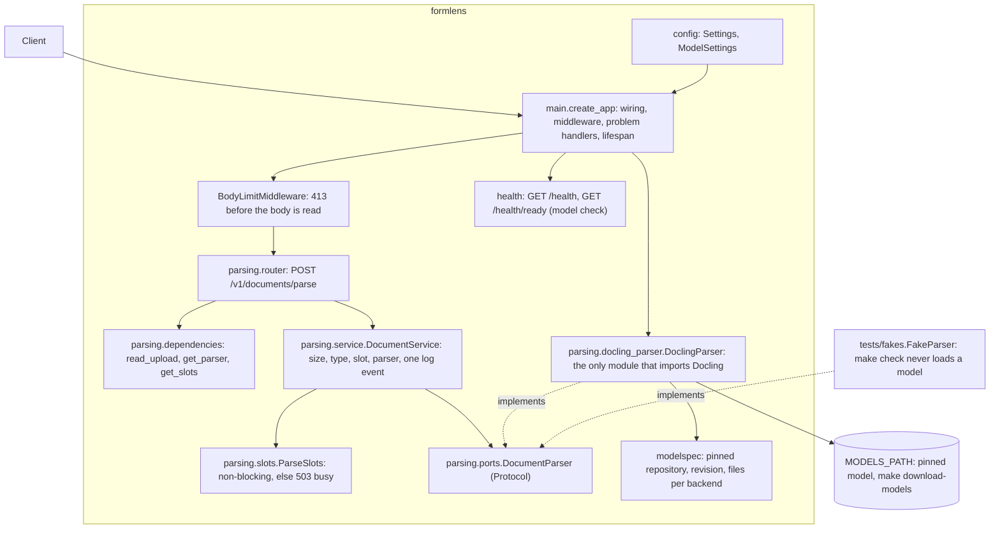

# Architecture

## Domain first, layers inside

Top-level packages are business areas; the layers (router, schemas, service, repository) sit
inside each. A change to one area edits one folder. `health` is the one area the core ships.

## Module shapes, and one rule for choosing

- **Default shape**: router, schemas, models, service, repository. The service is a few lines and
  holds no rule that belongs to a domain object. Every new module starts here.
- **Hexagonal shape**: `domain/` holds the rules as methods of the domain objects and imports
  nothing but the standard library; `domain/ports.py` declares what the module needs;
  `service_layer/` gathers facts and calls the domain; `adapters/` implement the ports;
  `entrypoints/` is the HTTP side.

Structure is added to one module at a time, when it hurts: the same rule copied in several places,
a rule test that needs a database, business terms missing from the code. Do not convert a module
to match another.

## Import direction

Routers depend on services, services on the domain and its ports, adapters on the domain. The
domain imports no web framework, no ORM, no adapter. Only `dependencies.py` and the code that
wires the app (`main.py`) import adapters. Modules refer to one another by id and never import
each other's models. `make imports` enforces the contracts in `pyproject.toml`.

The core has layers of its own, top to bottom: `__main__` (the only module that imports uvicorn), the
factory `main.py`, `migrations` (the only module that imports Alembic), `extractions`, the features
(`health`, `middleware`, `openapi`, `logging_config`, `parsing`, `templates`), then `pagination` and
`database` (the only module that builds an engine), then the foundations (`problems`, `config`, `query`, `types`,
`patterns`), then `modelspec` (the pinned models, standard library only). A layer imports only the layers
below it; `|` in the contract makes modules of one layer independent of each other, which is why `pagination` is
below the features and not beside them (`templates` imports it).
`parsing` has layers of its own (router, dependencies, service, then slots, ports and models, then
exceptions), and three more contracts keep the document stack (`docling`, `torch`, `transformers`,
`mlx_vlm`, `PIL`) inside `parsing/docling_parser.py`, which only `main` imports. A new core module joins the contract in the layer it belongs to.

## The two Stage 2 modules

**`templates` (default shape)** holds the description of a form. `models.py` has frozen dataclasses whose
invariants raise `InvalidTemplate` when an object is built, so a `Template` that exists is valid; `json_schema.py`
turns the fields into a JSON Schema (pure: every field is a required key that may be `null`); `repository.py` is a
Protocol and its SQLite adapter, and `replace` bumps the version in one `UPDATE`. SQLAlchemy is imported only
by `repository.py` and `tables.py`.

**`extractions` (hexagonal)**, because its rules (a job's life, retries, recovery, the queue) are easy to get wrong
and need a database to test otherwise:

- `domain/` is the standard library only: `Extraction` (frozen; `claim`, `complete`, `fail`, `retry`,
  `requeue_busy`, `interrupted`, `is_expired`, `missing_required`), `TemplateSnapshot`, the ports
  (`ExtractionRepository`, `TextSource`, `FieldExtractor`, `TemplateCatalog`, `Deadline`) and the errors.
- `service_layer/` has `ExtractionService` (`submit`, `get`) and `ExtractionProcessor` (`run_once`, `recover`,
  `purge_expired`). `run_once` is synchronous and one job, so a test drives it with fakes and a fake clock.
- `adapters/` implement the ports: the SQLite repository, Docling text (through `parsing.service`), the Ollama
  extractor, the template catalog (through `templates.service`, plain data only) and `ThreadDeadline`.
- `entrypoints/` has the routes, the error mapping and the worker (an asyncio task that calls `run_once` on a
  thread).

Contracts: `entrypoints` above the service layer and the adapters (independent of each other) above `domain`;
the domain and the service layer import no framework, database, client or adapter; `httpx2` and `jsonschema`
only in the Ollama adapter.

## Wiring

`create_app(settings, *, parser_factory=None, extractor_factory=None, start_worker=True)` builds the app.
Adapters are built once and stored on `app.state`; dependencies read them from the request, so tests replace them
with `app.dependency_overrides` and the app never has module-level state. Building the app touches no database
and starts nothing. The lifespan does, in this order: check that the database is at the newest revision (it logs
`database_not_migrated` with a hint and stops the start), load the parser, build the extractor and the processor,
**recover** the jobs a stop left running, start the worker. Tests use `start_worker=False` and call `run_once`.

## Logging is configured twice, on purpose

`configure_logging(settings)` runs in `__main__.main()` and again inside every `create_app()`. It
is idempotent: it removes only the handler it installed before it installs a new one, so the
second call replaces the first instead of doubling every line. `main()` configures logging before
it hands control to uvicorn, which then starts with `log_config=None`. `create_app()` configures it
again because the app can be built without `main()`: by `uvicorn <package>.main:create_app
--factory`, and by every test.

## Why handlers are sync `def`

Routes run in Starlette's threadpool. The service does no async I/O, and plain `def` makes
parallel tests meaningful: concurrent requests really run at the same time. Switch a route to
`async def` only when it awaits something, and then give each awaited call a timeout.

## Strict input without surprises

Pydantic's lax mode reads `0` as `1970-01-01` and `"3"` as `3`, which the spec does not allow.
Dates use `IsoDate` and integers use `WholeNumber` (a whole number, written `3` or `3.0`, never a
string or a bool). Whole-model strict mode was rejected because it also refuses valid date and UUID
strings.

## Concurrency

A rule that reads before it writes is guarded by one atomic step, and each guard has a parallel
test that fails without it. See [add-a-module](../how-to/add-a-module.md).

## FormLens components

`src/formlens/parsing/` is the first domain module. The service depends on the `DocumentParser`
Protocol; the Docling adapter implements it and a fake implements it for the tests, so `make check`
runs without a model. `build_docling_parser` is the one function that loads Docling and the model; it
runs once, in the lifespan, in a worker thread. The model comes from `MODELS_PATH` only and is never
fetched at run time. The import contracts (`make imports`) keep Docling, torch, transformers,
mlx-vlm and Pillow out of everything but the adapter, and the adapter out of everything but `main`.

## Decisions

- **Python 3.15 stays.** `docling[vlm]` installed on Python 3.15.2 and resolved and locked with
  `uv sync --locked` (186 packages in `uv.lock`, the release group included). The 3.14 fallback was not needed.
- **Docling is a runtime dependency.** `docling[vlm]` and `python-multipart` are in
  `[project].dependencies` and locked. `import formlens.main` imports neither Docling nor torch: the
  adapter imports Docling inside `build_docling_parser`, and a test in a child interpreter checks
  `sys.modules`.
- **The preset API, with `pipeline_cls`.** The adapter builds
  `VlmConvertOptions.from_preset("granite_docling", engine_options=...)` with
  `MlxVlmEngineOptions` or `TransformersVlmEngineOptions`, and sets `pipeline_cls=VlmPipeline` on
  both the PDF and the image format option. The legacy `GRANITEDOCLING_MLX` options raise a
  `DeprecationWarning`, which is an error under `filterwarnings`. This was checked against docling
  2.149.0. A test compares the repository the preset resolves with the one in `modelspec.py`.
- **The model is loaded once, at start-up.** The lifespan builds the parser in a worker thread and
  loads the model for PDF and image input. A failure logs `model_load_failed` once (backend, models
  path, reason and the `make download-models` hint) and stops the start; readiness (`model`) is 503
  until the parser exists. `build_docling_parser` checks the whole file list of the pinned model
  first, because Docling does not notice an incomplete folder and fails in the middle of a request.
- **`document_timeout` is soft.** `PARSE_TIMEOUT_SECONDS` goes to Docling as `document_timeout`.
  `VlmPipeline` checks it after each batch of `settings.perf.page_batch_size` pages (4 in docling
  2.149.0, read from `docling/pipeline/vlm_pipeline.py`) and once after the last, so a long document
  overshoots by up to a batch and a document that finishes over the budget fails too (measured: a
  1 s budget failed a one-page PNG that took 1.59 s, and took 7.35 s on a 5-page PDF). A timeout, a
  failure and a partial success are all 500 `parse-failed`; an incomplete text is never returned.
  The log tells them apart by `conversion_status` (`partial_success` for a timeout).
- **The body cap is a pure ASGI middleware.** A `Content-Length` over `MAX_UPLOAD_MB` is a 413 at
  once; a chunked body is counted and cut a megabyte past the limit; the service still checks the
  exact size. The middleware never raises from `receive`.
- **The type comes from magic bytes.** PDF (`%PDF-` in the first 1024 bytes), PNG, JPEG and TIFF
  are told apart by their first bytes; the client's `Content-Type` and file name are ignored, and
  the file name is never read, so it cannot reach a log. Empty is 400, an unknown signature is 415,
  a known signature that Docling cannot open is 400.
- **A full parser answers 503, not a queue.** `ParseSlots` is a `BoundedSemaphore` taken without
  blocking; when every slot is taken the request gets 503 `parser-busy` with a constant
  `Retry-After` of 5 seconds. A parallel test (`concurrency` marker) proves it. Removing the guard
  fails it, and so does a non-atomic counter whose window a sleep widens (both run from a copy of the repository). A plain
  `if free > 0: free -= 1` counter, with no widening, passed 20 of 20 runs on the GIL build: only the
  free-threaded build can expose it, and that CI job is switched off. The 300-round test checks that no slot
  leaks or is doubled, but a plain counter passes it on the GIL build; it is written for the
  free-threaded one.
- **The adapter writes a temporary file under a neutral name.** Docling logs the input file name at
  INFO; the adapter writes `upload.<ext>` into a fresh temporary folder, removed also on error.
  The loggers of Docling and its libraries are held at `WARNING`; the multipart parser's
  (`python_multipart`, `multipart`) at `ERROR`, because at `WARNING` it quotes a byte of a malformed
  body (`_BODY_LOGGERS` in `logging_config.py`). The redaction masks keys that could hold a document
  or its name.
- **The model pins and the two model settings have one source each.** `src/formlens/modelspec.py`
  holds the repository, revision and file list per backend. `ModelSettings` in `config.py` holds
  `MODELS_PATH` and `VLM_BACKEND`; `Settings` inherits it, and `scripts/resolve_model.py` reads it
  for `make download-models`. A `.env` therefore moves the download and the service together.
  `tests/test_docs.py` keeps `docs/licenses.md` in step with the pins.
- **The model is downloaded by a script, not by Docling.** `make download-models` downloads the
  revision pinned in `modelspec.py` into `MODELS_PATH/<owner>--<repo>`, the folder name Docling
  looks for under its `artifacts_path`, so the adapter passes `settings.models_path` unchanged.
- **Tests that need the model are `slow`.** `make check` deselects them; `make test-models` runs
  all of them (`pytest -m slow`) and fails, not skips, when the files are missing. They read only
  `MODELS_PATH` and `VLM_BACKEND`. They parse the synthetic documents through the real adapter, and
  an offline test runs the service in a child process that records every network attempt
  (`HF_HUB_OFFLINE` is read when `huggingface_hub` is imported, so the process must be new).
- **Schemathesis fuzzes a fake-parser app.** `tests/schemathesis_app.py` builds the real app around
  a `FakeParser`; `scripts/run_schemathesis.sh` starts it with `uvicorn --factory`. The production
  code has no switch for it. The operation allows 415 for a schema-valid request, as Schemathesis
  documents for a rejection the schema cannot express (the signature of a file). Because of that
  allowance Schemathesis never reaches a 200 here; `tests/parsing/test_contract.py` covers the 200, 413,
  500 and 503 answers against the committed `openapi.json`.
- **The core modules stay.** `pagination`, `query` and `types` have no caller yet; later list
  endpoints use them. `tests/probes.py` still serves the core tests.

## Stage 2 decisions

The numbering is the plan's.

- **D1 Language model.** Ollama, `qwen3:8b` by default (`LLM_MODEL` is a setting), thinking off, structured output.
  The default is a choice: the golden set decides. Its licence and digest are not verified (see
  [licenses](../licenses.md)).
- **D2 `extractions` is hexagonal**, `templates` is the default shape.
- **D3 Migrations are explicit.** `python -m formlens migrate` or `make migrate`; the service only checks the
  database is at head, and the container migrates before it serves. There is no `create_all`.
- **D4 The queue has a cap.** `QUEUE_MAX_PENDING`; one `INSERT ... SELECT ... WHERE (count) < cap` is the guard.
- **D5 Scope.** Text only, one worker in the API process, SQLite, no Redis or Celery.
- **D6 The template is copied at submit time**: the extraction stores its id, version, fields and schema, with no
  foreign key. **D9** follows: deleting a template is a 204 and never a conflict.
- **D7 "Idempotency is 1".** A late result is applied at most once, and not at all after a timeout: the terminal write
  is `UPDATE ... WHERE status = 'running' AND attempts = ?`. Attempts are counted when a job is claimed.
- **D8 Retries.** Terminal at once: timeout, invalid file, document too long. Retried while attempts remain
  (`JOB_MAX_ATTEMPTS`, 2): a parse failure, an unreachable model, an answer that fails the schema. A busy parser
  gives the attempt back. An error nobody translated ends the job as `interrupted`.
- **D10 Retention.** A finished extraction is kept `RESULT_TTL_HOURS`; reads treat an expired one as not found
  before the purge has run; the worker purges at start and about once a minute; the upload is deleted when the job
  ends.
- **D11 One request.** `POST /v1/extractions` is multipart: the `file` (the existing `read_upload`) and a `Form`
  field `template_id`.
- **D12 Golden set.** In the repository, synthetic only, seeded; `make evaluate`; no number is claimed until it has
  run.
- **D13 The upload waits in a table** (`extraction_inputs`, a BLOB), deleted when the job ends.
- **D14 The model server must be local**: `LLM_BASE_URL` is a loopback or private address, a name without a dot or
  `host.docker.internal`; the client ignores the proxy variables.
- **D15 Missing required fields.** A `null` in a required field is still `completed`; `missing_required` says which.
- **D16 Context.** The text is bounded by `LLM_MAX_INPUT_CHARS` (`document_too_long`); the output is validated with
  `jsonschema`, which is the contract; temperature 0 and a fixed seed. If Ollama's `/v1` endpoint ignores the context
  size, a derived model from a Modelfile is the fix (see [run the LLM](../how-to/run-the-llm.md)).
- **D17 Client regular expressions** run in a linear-time engine (`patterns.py`): lookaround and backreferences are
  refused when the template is made. Python's `re` took 4.8 s on `(a+)+$` with 26 characters, and a thread stuck
  in it cannot be stopped, so the queue would stop for good.
- **D18 Names.** The spec's `invalid_request` is the existing `validation-error`; slugs stay kebab-case.
- **The worker stops with a bound.** `anyio`'s `abandon_on_cancel=True` plus a wait of `GRACEFUL_SHUTDOWN_SECONDS - 2`;
  a job that is still running is left behind and recovered at the next start. A job that timed out is an
  abandoned thread: nothing is claimed until it has ended.
- **Follow-up.** Handwriting and checkboxes through a vision model are not covered; the text is read by Docling and
  a text model.

## Open issues

- **The extraction has never run against a real Ollama.** The request fields (`response_format` with a JSON
  Schema, `reasoning_effort`, `seed`) were not checked against Ollama's documentation or a running server; the
  adapter strips a `<think>` block and validates every answer, so a wrong field is visible, not silent. The
  accuracy of the model on the golden set is unmeasured; see the README.

- **`pip-audit` and Dependabot on `torch 2.15.0+cpu`.** On Linux the lock pins `torch` and
  `torchvision` to the CPU wheels of `https://download.pytorch.org/whl/cpu` (`[tool.uv.sources]`
  with an explicit index and `sys_platform == 'linux'`; they are direct dependencies because
  `sources` apply to those only). `+cpu` is a local version that is not on PyPI, so pip-audit skips
  it (and exits 0). `make audit` therefore strips `+cpu` before auditing, so the same release on
  PyPI is checked; this was shown with a known-vulnerable `torch==1.13.0`. Dependabot's behaviour
  on the second index is unverified. A new `torch` release must exist on both indexes before
  `uv lock` can take it.
- **The `transformers` backend and the container have not been run.** Only `mlx` on Apple Silicon was
  downloaded, loaded and measured. The Docker build and the container start were not run either:
  the builder stage gets `build-essential` because `pyclipper` and `tree-sitter` have only source
  distributions for Python 3.15; that is unverified.
- **The `mlx-vlm` publisher is not confirmed by a person** (see [licenses](../licenses.md)).
- **The free-threaded CI job is switched off**: the locked dependencies have no free-threaded wheels
  (`av`, `docling-parse`, pyarrow).
- **`document_timeout` does not stop a batch of pages** (see Decisions): it is checked after each
  batch of 4 pages, so it is a budget that is judged afterwards, not a deadline.
- **The image's Docling and torch imports were never run.** `docker run --rm formlens:local python -c
  "import docling.document_converter, torch"` is a step of the `docker` CI job and the first place
  that proves the image can import them (it runs without `--read-only`, `--tmpfs` and the models
  mount, so a failure that only the read-only container causes stays hidden): the start-up check stops at `missing_model_files`, before
  any Docling import. The step was written, never run (no Docker daemon here, and CI has not run it).
