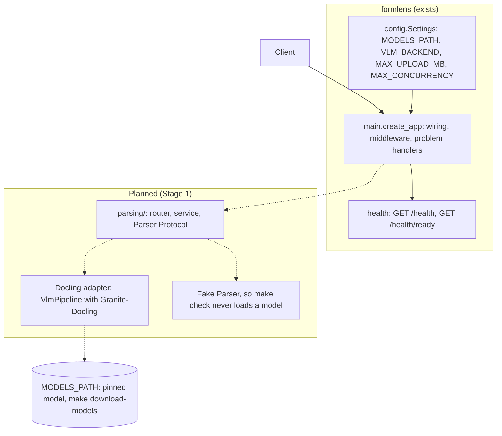

# Architecture

## Domain first, layers inside

Top-level packages are business areas; the layers (router, schemas, service, repository) sit
inside each. A change to one area edits one folder. `health` is the one area the core ships.

## Module shapes, and one rule for choosing

- **Default shape**: router, schemas, models, service, repository. The service is a few lines and
  holds no rule that belongs to a domain object. Every new module starts here.
- **Hexagonal shape**: `domain/` holds the rules as methods of the domain objects and imports
  nothing but the standard library; `domain/ports.py` declares what the module needs;
  `service_layer/` gathers facts and calls the domain; `adapters/` implement the ports;
  `entrypoints/` is the HTTP side.

Structure is added to one module at a time, when it hurts: the same rule copied in several places,
a rule test that needs a database, business terms missing from the code. Do not convert a module
to match another.

## Import direction

Routers depend on services, services on the domain and its ports, adapters on the domain. The
domain imports no web framework, no ORM, no adapter. Only `dependencies.py` and the code that
wires the app (`main.py`) import adapters. Modules refer to one another by id and never import
each other's models. `make imports` enforces the contracts in `pyproject.toml`.

The core has layers of its own: `__main__` (the only module that imports uvicorn), then the
factory `main.py`, then the features (`health`, `middleware`, `openapi`, `logging_config`,
`pagination`), then the foundations (`problems`, `config`, `query`, `types`). A layer imports only
the layers below it. A new core module joins the contract in the layer it belongs to.

## Wiring

`create_app(settings)` builds the app. Adapters are built once and stored on `app.state`;
dependencies read them from the request, so tests replace them with `app.dependency_overrides` and
the app never has module-level state.

## Logging is configured twice, on purpose

`configure_logging(settings)` runs in `__main__.main()` and again inside every `create_app()`. It
is idempotent: it removes only the handler it installed before it installs a new one, so the
second call replaces the first instead of doubling every line. `main()` configures logging before
it hands control to uvicorn, which then starts with `log_config=None`. `create_app()` configures it
again because the app can be built without `main()`: by `uvicorn <package>.main:create_app
--factory`, and by every test.

## Why handlers are sync `def`

Routes run in Starlette's threadpool. The service does no async I/O, and plain `def` makes
parallel tests meaningful: concurrent requests really run at the same time. Switch a route to
`async def` only when it awaits something, and then give each awaited call a timeout.

## Strict input without surprises

Pydantic's lax mode reads `0` as `1970-01-01` and `"3"` as `3`, which the spec does not allow.
Dates use `IsoDate` and integers use `WholeNumber` (a whole number, written `3` or `3.0`, never a
string or a bool). Whole-model strict mode was rejected because it also refuses valid date and UUID
strings.

## Concurrency

A rule that reads before it writes is guarded by one atomic step, and each guard has a parallel
test that fails without it. See [add-a-module](../how-to/add-a-module.md).

## FormLens components

Stage 0 ships the empty service. Everything marked *planned* (dotted arrows) arrives in Stage 1 or later and does not exist yet.

The first domain module is `src/formlens/parsing/`, in the default shape. It depends on a `Parser`
Protocol; the Docling adapter implements it, and a fake implements it for tests, so the gate runs
without a model. The model is loaded from `MODELS_PATH` only, never fetched at run time.

## Decisions

- **Python 3.15 stays.** A scratch environment installed `docling[vlm]` on Python 3.15.2, the
  imports of `docling` and `mlx_vlm` worked, and one synthetic page converted through
  `VlmPipeline` with the MLX model in 8 s with `HF_HUB_OFFLINE=1`. `uv add 'docling[vlm]'` also
  resolved and locked in a throwaway copy of the project (189 packages) and `uv sync --locked`
  passed there. The 3.14 fallback was not needed.
- **Docling is not a dependency yet.** Stage 0 has no code that imports it. Whether it becomes a
  runtime dependency or a dependency group is decided in Stage 1, when the adapter exists.
- **The model is downloaded by a script, not by Docling.** `make download-models` pins a revision
  and writes `MODELS_PATH/<owner>--<repo>`, the folder name Docling looks for under its
  `artifacts_path` (`resolve_model_artifacts_path` in `docling/models/inference_engines/vlm/_utils.py`),
  so Stage 1 can pass `settings.models_path` unchanged.
- **Tests that need the model are `slow`.** `make check` deselects them; `make test-models` runs
  them and fails when the files are missing. A conversion test with the real model is a Stage 1
  task.
- **The core modules stay.** `pagination`, `query` and `types` have no caller yet; later list and
  upload endpoints use them. `tests/probes.py` still serves the core tests.

## Carry-forward notes for Stage 1

Nothing here is implemented. Do each item when the module that needs it exists.

- **Known gap: two sources of defaults.** `scripts/download_models.sh` repeats in bash the defaults
  and the validation that `Settings` holds (`VLM_BACKEND`, `MODELS_PATH`), and it never reads
  `.env`. A `.env` with `VLM_BACKEND=transformers` or `MODELS_PATH=/elsewhere` moves the service
  but not `make download-models`, and `make test-models` builds `Settings(_env_file=None)`, so it
  ignores `.env` too. Today only a test keeps the script and `Settings` in agreement
  (`tests/test_download_models.py`). Give both one source, for example by having the script ask
  `Settings` for the values, and drop the copy.

- Pin the `docling`, `transformers`, `huggingface_hub` and `PIL` loggers to `WARNING` in
  `configure_logging`, so a dependency cannot flood the log or print a document's text at `DEBUG`.
- Extend `SENSITIVE_PARTS` in the redaction processor with the field names that will carry document
  content or file names, and keep uploaded text out of log events altogether.
- Check that `VlmPipeline` fetches no other model or file at run time (run a conversion with
  `HF_HUB_OFFLINE=1` as the Stage 0 launch test did, and with the network cut).
- Add the problem types the upload route needs (413 too large, 415 unsupported media type, 503
  busy), each with its row in `docs/reference/problem-types.md`, and add `python-multipart`.
- Guard concurrency with one atomic semaphore: when `MAX_CONCURRENCY` conversions are running,
  answer 503 or 429 with `Retry-After`. Prove it with a parallel test marked `concurrency`, then
  remove the guard once and confirm the test fails.
